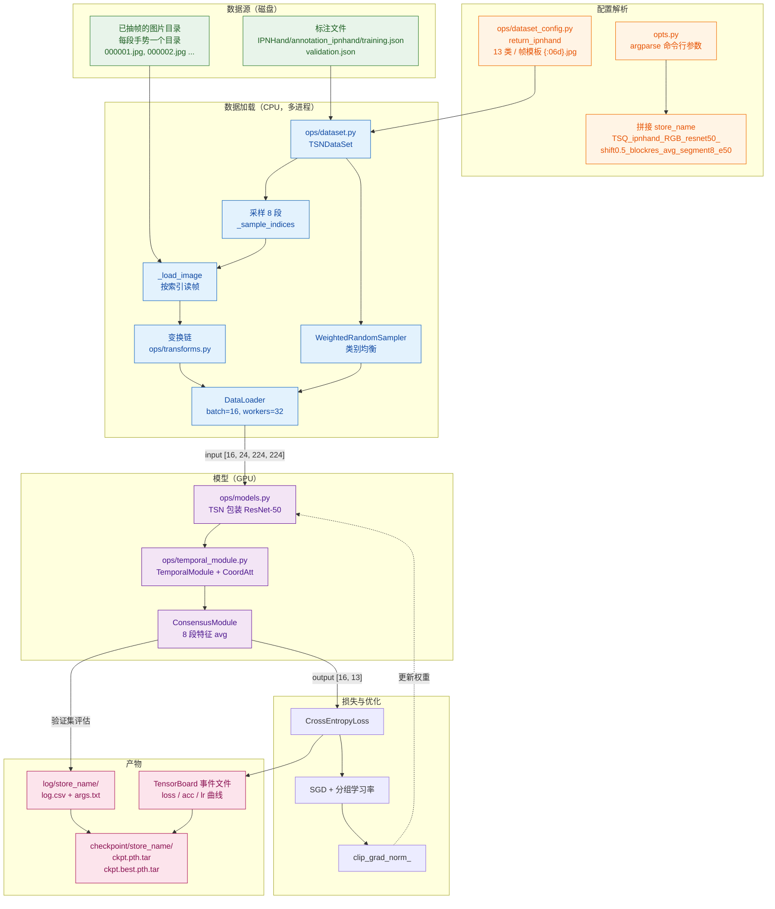
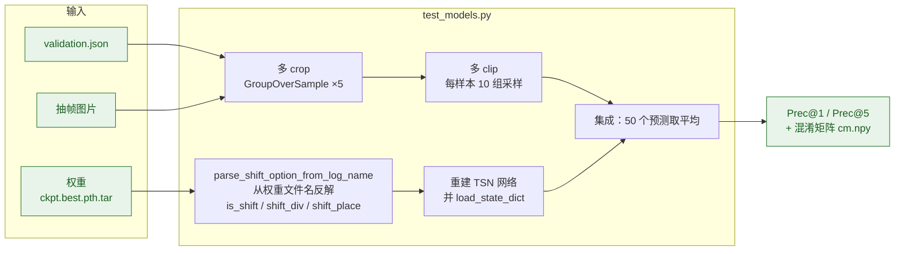
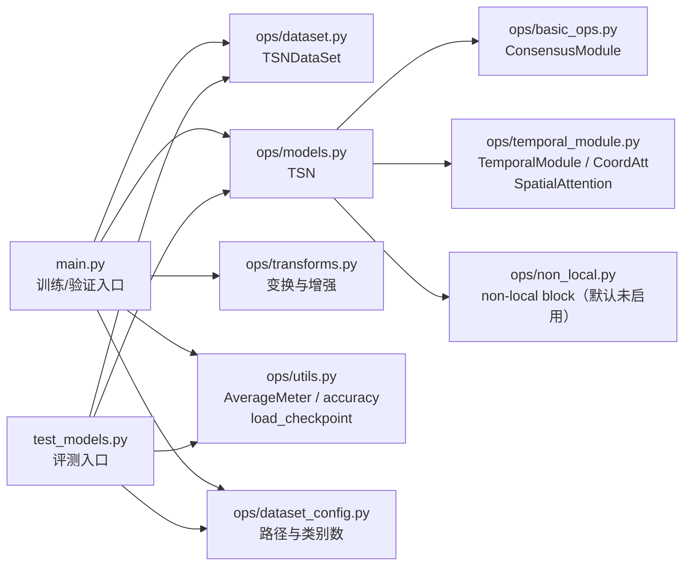

# 01 · 端到端总览

从 IPN-Hand 数据集的 JSON 标注到最终预测结果的完整链路。

## 训练路径

## 评测路径

## 两条路径的关键差异

| | 训练路径 | 评测路径 |
|---|---|---|
| 入口 | `main.py` | `test_models.py` |
| 采样 | 训练集随机采样；验证集居中采样 | 10 组随机采样（`--multi_clip_test`） |
| 空间裁剪 | 随机裁剪 + 颜色抖动 + RandomErasing | 5 crop 过采样（四角 + 中心） |
| 水平翻转 | 按概率翻转，并同步对调左右类标签 | 不翻转 |
| BN 行为 | `model.train()`，partial BN 关闭即全部更新 | `model.eval()`，用滑动统计量 |
| 集成 | 8 段特征 avg（`ConsensusModule`） | 50 个预测再取平均 |
| 输出 | 权重 + 日志 + TensorBoard | Prec@1 / Prec@5 + 混淆矩阵 |

## 模块与文件对应

> 详细拆解见后续各篇：数据加载 [02](02-data-loading.md)、模型前向 [03](03-model-forward.md)、
> 训练回路 [04](04-train-loop.md)、评测流程 [05](05-eval-pipeline.md)。
