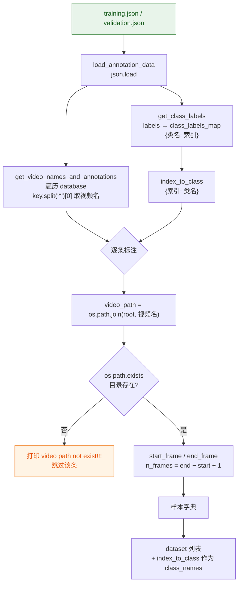
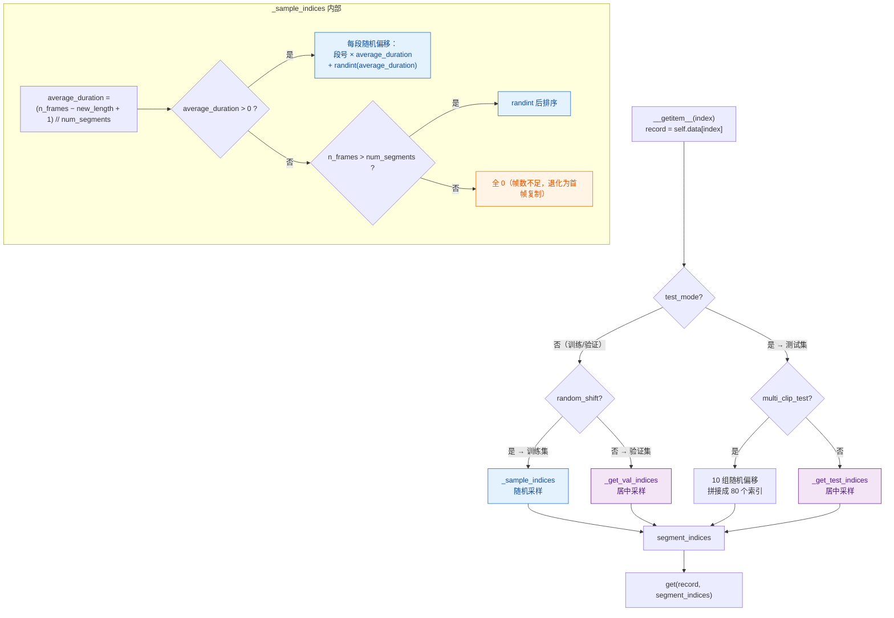
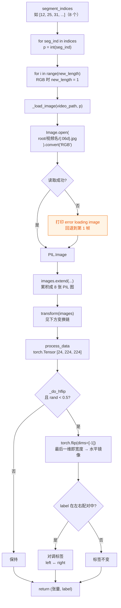
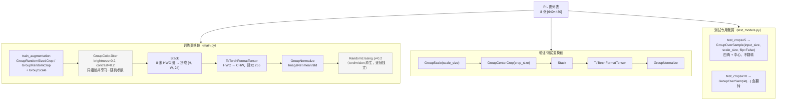
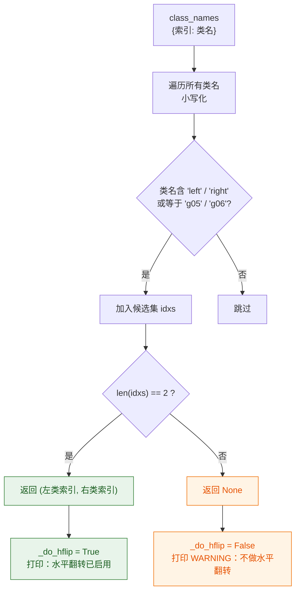
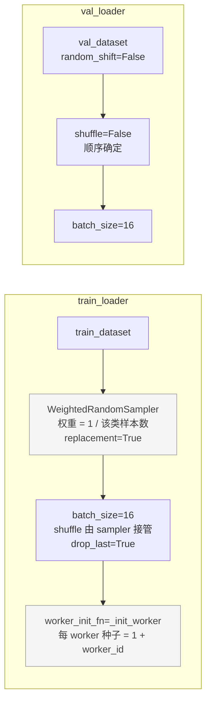
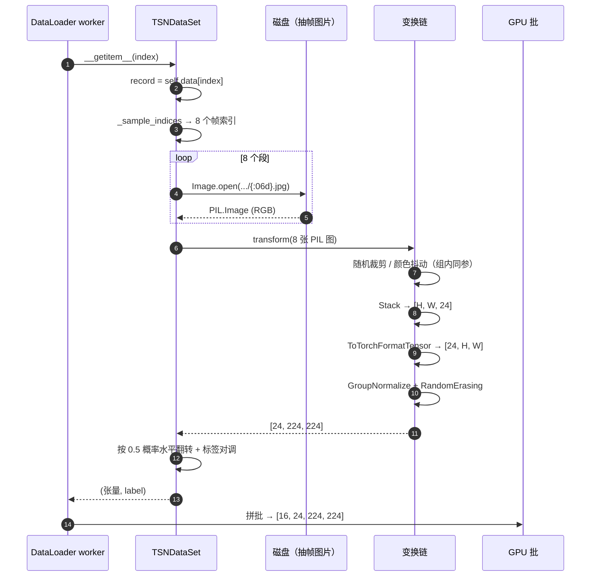

# 02 · 数据加载与增强

对应 `ops/dataset.py` 与 `ops/transforms.py`。IPN-Hand 的数据是**已抽帧的图片**，
不是视频文件，因此每次取样本都是「按索引开图」。

## 标注解析：从 JSON 到样本列表



产出的样本字典 `sample`：

| 字段 | 含义 |
|---|---|
| `video_path` | 该段手势的帧目录绝对路径 |
| `segment` | `[start_frame, end_frame]` |
| `start_frame` / `end_frame` | 起止帧号（JSON 里是浮点字符串，转 int） |
| `n_frames` | 有效帧数 |
| `video_id` | 在 dataset 中的序号 |
| `label` | 类别索引，由 `class_to_index` 映射得到 |
| `frame_indices` | `range(start, end+1)` 列表 |

> ⚠️ 关键点：标注描述的是**一段手势在长视频中的时间区间**，而不是一整段视频。
> 所有采样都在 `[start_frame, end_frame]` 内进行，最后要加回 `start_frame` 偏移。
> `ops/dataset.py` 里的关键行：`return offsets + record['start_frame']`。

## 采样：如何从 n_frames 里挑出 8 帧



三种采样策略的对比：

| 策略 | 触发条件 | 偏移计算 | 用途 |
|---|---|---|---|
| 随机采样 | 训练集（`random_shift=True`） | `段号 × 平均时长 + randint(平均时长)` | 时间抖动，等价于时序增强 |
| 居中采样 | 验证集（`random_shift=False`） | `tick/2 + tick × 段号`，`tick = n_frames/8` | 确定性，便于比较 |
| 多 clip | 测试集 `--multi_clip_test` | 上述随机偏移重复 10 次，拼接 80 个索引 | 评测时降低采样方差 |

## 取帧：索引到张量



`torch.flip(dims=[-1])` 之所以是水平翻转：张量布局为 `[C, H, W]`，最后一维是宽度。
整段 8 帧在 `Stack` 之后已经拼成同一个张量，所以一次 flip 就是**8 帧一起镜像**，
不会出现帧间翻转不一致的问题。

## 变换链



### 为什么 Group* 前缀很重要

`Group` 系列变换（`GroupRandomCrop`、`GroupScale`、`GroupColorJitter`、`GroupNormalize`…）
对**同一段内的所有帧施加完全相同的随机参数**。如果用 torchvision 原生的逐帧变换，
8 帧会各自独立随机裁剪/调色，等于给时序通道注入噪声，破坏运动信息。

这也是 `GroupColorJitter` 被单独实现的原因 —— 原生 `ColorJitter` 不支持 group 语义：

```python
class GroupColorJitter(object):
    def __call__(self, img_group):
        b = 1.0 + random.uniform(-self.brightness, self.brightness)
        c = 1.0 + random.uniform(-self.contrast, self.contrast)
        # 参数在循环外抽一次，组内 8 帧共用
        for img in img_group:
            img = ImageEnhance.Brightness(img).enhance(b)
            img = ImageEnhance.Contrast(img).enhance(c)
```

> 例外：`RandomErasing` 是逐帧独立的。它作用在已归一化的张量上，模拟局部遮挡，
> 逐帧独立反而是一种正则化，不破坏整体运动方向。

## 水平翻转与标签对调

这是本仓库相对上游 TSM 的一个重要改动，逻辑在 `_find_lr_pair`：



设计要点：**宁可不翻转，也不翻转错标签**。

镜像是左右互换的：一个「向右」的样本翻转后视觉上就是「向左」。
如果只翻转图像而不改标签，模型就会学到「向右 = 左手向右划」这种错误监督，
而且这种错误是**静默的**（loss 正常下降，只有方向类准确率上不去）。

所以只有**恰好**识别出两个方向类时才启用翻转；类名规则对不上就整体关闭，
并打印 WARNING 提示补充规则。

## DataLoader 组装



- `drop_last=True`：丢弃不足一个批的尾部，避免多卡 DataParallel 下批大小不整除。
- `worker_init_fn`：给每个 worker 设 `random` / `numpy` / `torch` 种子，保证多进程
  数据增强可复现。注意 `main.py` 里还统一设了全局种子（`torch.manual_seed(1)` 等）。
- `WeightedRandomSampler` 与 `shuffle=True` 互斥 —— 用了 sampler 就不能再开 shuffle。

## 小结：一条训练样本的完整旅程


