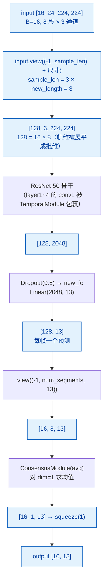
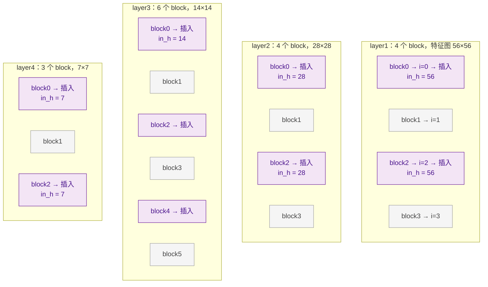
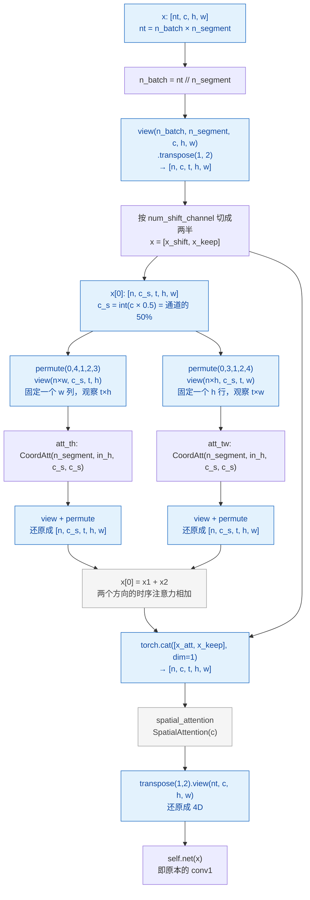
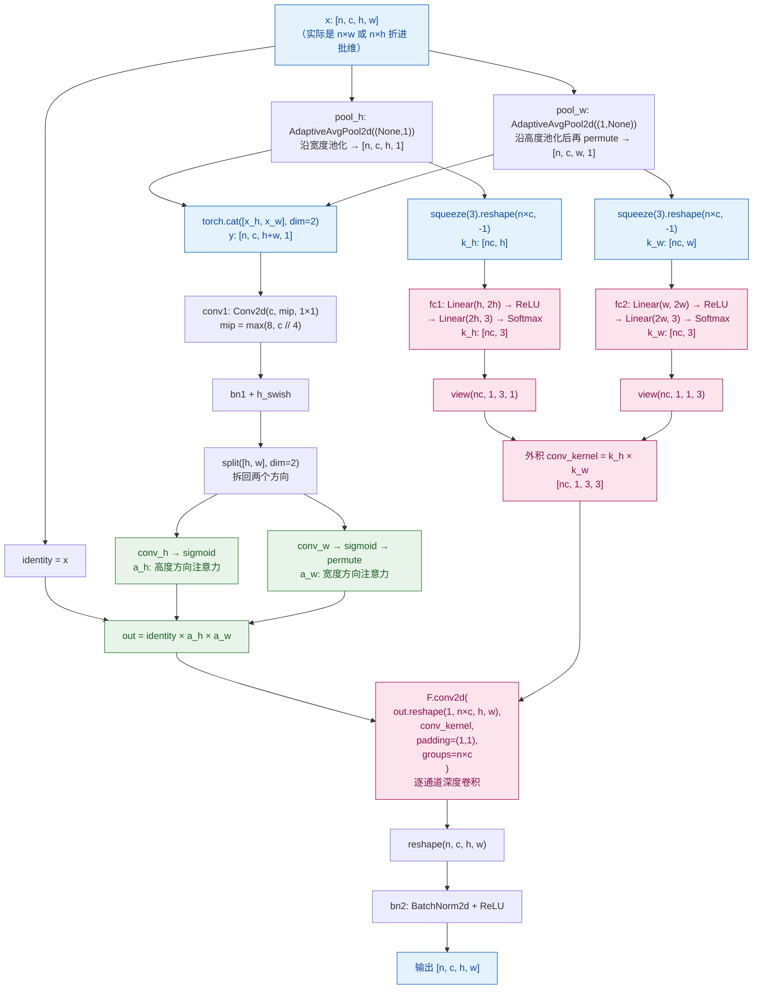
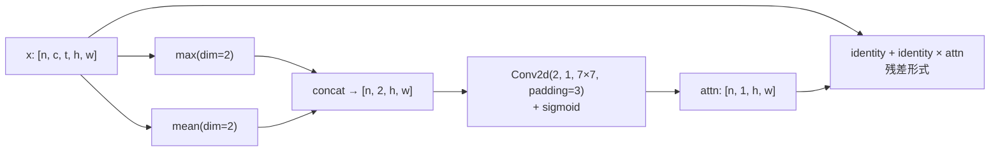
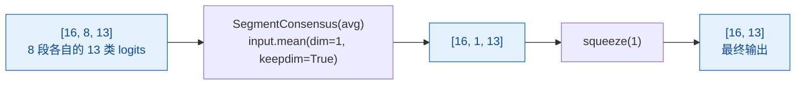
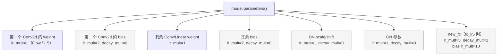

# 03 · 模型前向与形状流转

对应 `ops/models.py`、`ops/temporal_module.py`、`ops/basic_ops.py`。

## 整体前向



关键理解：**TSM 把「时间」折叠进了批维**。
8 帧不是作为 5D 张量 `[B, 8, 3, H, W]` 送进 3D 卷积，而是展平成 `[B×8, 3, H, W]`
交给标准 2D ResNet。帧与帧之间的信息交换由 `TemporalModule` 在两个空间位置之间
「搬运」通道来实现 —— 这样就能直接复用 ImageNet 预训练的 2D 权重。

## TemporalModule 的插入位置

`make_temporal_module` 把每个残差块的 `conv1` 替换成 `TemporalModule(b.conv1, ...)`：



`make_temporal_module` 的规则（`place='blockres'`）：

- `n_round = 1`，但如果 `len(layer3) >= 23` 则设为 2。ResNet-50 的 `layer3` 只有 6 个 block，
  所以 `n_round` 保持 1，即**每个 block** 都插入。
- 实际插入数：`layer1(4) + layer2(4) + layer3(6) + layer4(3，按 n_round 折算 2) = 16`

`h_list` 正好 16 项，与插入顺序一一对应：

```python
h_list = [56,56,56,56,       # layer1 前 4 个
          28,28,28,28,       # layer2 4 个
          14,14,14,14,14,14, # layer3 6 个
          7,7]               # layer4 的 block0 与 block2
```

`TemporalModule` 用类变量 `count` 递增取用 `h_list[count]`，因此
`make_temporal_module` 开头必须重置它：

```python
def make_temporal_module(net, n_segment, ...):
    TemporalModule.count = 0   # 避免同一进程多次 build 时越界
```

> ⚠️ 改动 `arch` / 输入分辨率 / `num_segments` 会让 `h_list` 失配，
> 需要同步维护这张表，否则会 `IndexError` 或取到错的 `in_h`。

## TemporalModule.forward 详细数据流



### 为什么是「固定 w 列 / 固定 h 行」

这是本仓库相对原始 TSM 的核心改动。原始 TSM 做的是 channel shift：
把一部分通道沿时间轴平移，实现零参数的帧间信息交换。

本仓库改为**注意力引导的移位**：把第 50% 的通道拿出来（`shift_div=0.50`），
分别从两个正交视角建模时序关系：

| 分支 | 张量组织 | 语义 |
|---|---|---|
| `att_th` | `[n×w, c_s, t, h]` | 固定某个宽度列，看「时间 × 高度」平面 |
| `att_tw` | `[n×h, c_s, t, w]` | 固定某个高度行，看「时间 × 宽度」平面 |

两个分支各自算出一份移位结果，相加后与未动的 50% 通道拼接。
这样既保留了 TSM「零额外分支、直接复用 2D 卷积」的轻量特性，
又让「往哪个时间方向移、移多少」由数据学出来，而不是固定的 ±1 帧。

## CoordAtt：用注意力算卷积核

`ops/temporal_module.py` 里改动最大的部分。它同时做两件事：
**算坐标注意力权重** 和 **生成动态 3×3 空间卷积核**。



### 三个技术要点

**1. 坐标注意力（原版 CoordAtt 思路）**
不直接把特征图压成 `[n, c, 1, 1]` 的全局向量，而是分别沿高度、宽度池化，
得到 `[n, c, h, 1]` 和 `[n, c, w, 1]`。这样注意力保留了**位置信息** ——
对细长的手势（如「向左划」）来说，手的位置和运动方向都重要。
两个方向共享 `conv1` 压缩，再各自 `sigmoid` 得到 `a_h`、`a_w`。

**2. 动态卷积核（本仓库改动）**
`fc1` / `fc2` 把池化后的 `[nc, h]`、`[nc, w]` 映射到 3 个值，`Softmax` 归一化，
再外积成 `[nc, 1, 3, 3]`。也就是说**每个样本、每个通道都有自己的一组 3×3 卷积核**，
由输入内容实时生成。

配合 `groups=n×c` 的深度卷积，等价于「逐通道做一次可变形的小邻域聚合」：

```python
out = F.conv2d(
    out.reshape(1, n * c, h, w),   # 把 n×c 折进批维，当成一个 batch
    conv_kernel,                   # [nc, 1, 3, 3]，每组核对应一个通道
    padding=(1, 1),
    groups=n * c                   # 分组数 = 通道数 → 深度卷积
)
```

**3. 与原始实现的差异**
原始版本用固定的深度可分离卷积 `conv_th` / `conv_tw`（3×3，参数静态），
本仓库把它们注释掉，换成上面的动态核方案。带来的变化：

- 参数量：新增两个 `Linear`（`2h²+6h` 量级），去掉了两个固定的 3×3 深度卷积
- 表达能力：卷积核随输入变化，对「不同手势、不同运动幅度」更自适应
- 约束：`in_h` 必须与特征图实际高度一致，因此需要 `h_list` 这张表

### SpatialAttention（补充分支）

`TemporalModule` 末尾还有一个 `SpatialAttention`：



它在时间维上池化，得到一个纯空间的 7×7 大核注意力，
以残差形式叠加（`identity + identity × attn`），让模型关注手部所在的区域。

## ConsensusModule：8 段如何合成一个预测



`basic_ops.py` 里还支持 `identity` 模式（不聚合），本仓库用 `avg`。
注意 `SegmentConsensus` 的 `dim` 默认为 1，与上面的 `[B, S, num_class]` 布局一致。

## 参数分组：为什么学习率不是一刀切

`get_optim_policies` 把所有参数按类型分成 9 组，每组有独立的 `lr_mult` / `decay_mult`：



主要考虑：

- **bias 不做 weight decay**（`decay_mult=0`）：偏置衰减到 0 会削弱表达能力。
- **BN 的 scale/shift 不做 weight decay**：同理。
- **分类头用更大学习率**（`lr_mult=5`）：`new_fc` 是随机初始化的，而骨干是预训练权重，
  让新层学得快一些。本仓库脚本传了 `--npb`（关闭 partial BN），
  同时 `fc_lr5` 在未指定 `--tune_from` 时为真。
