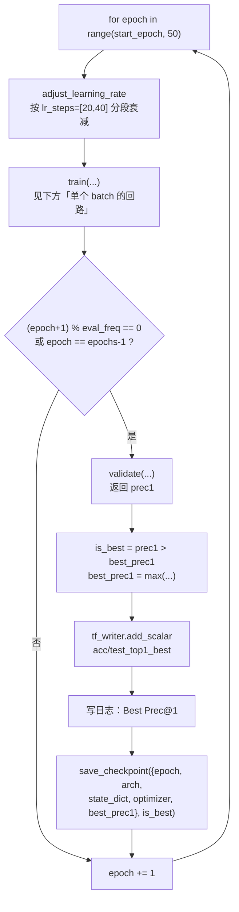
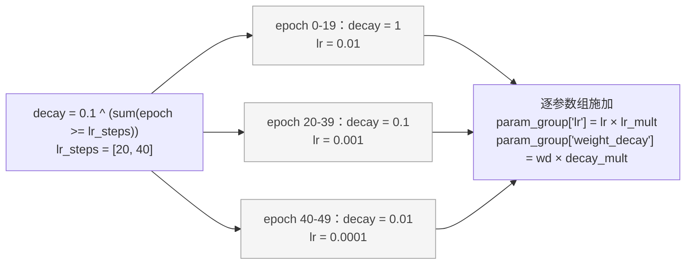
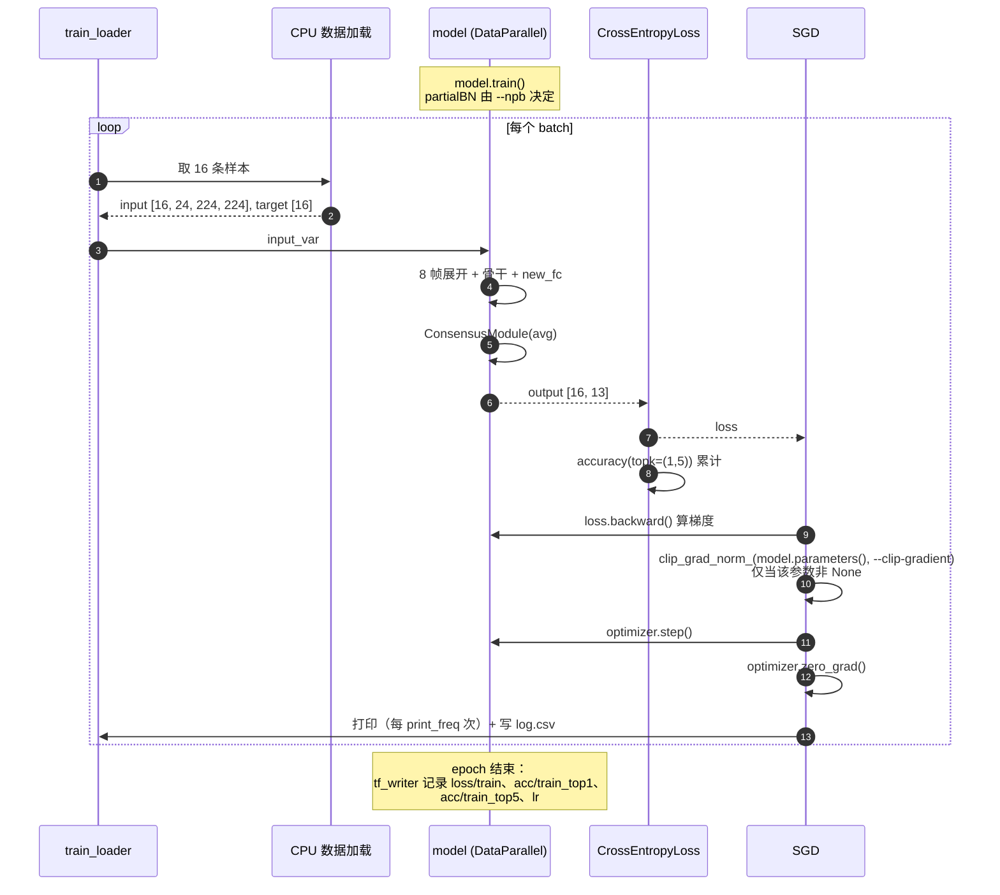
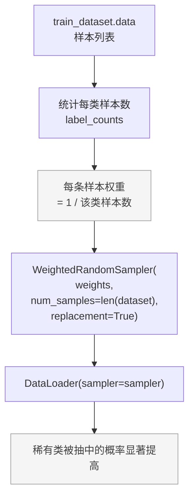
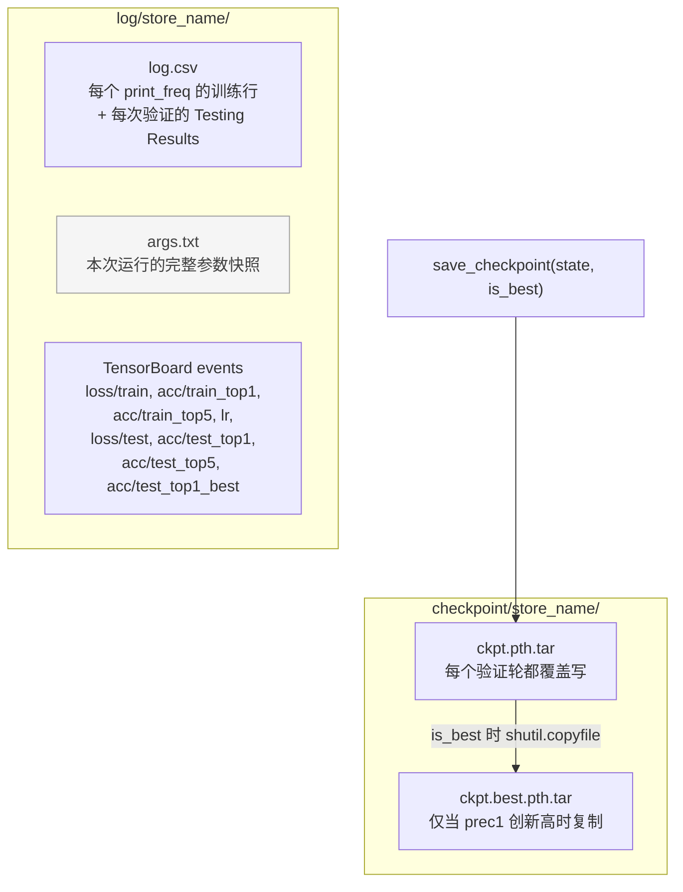
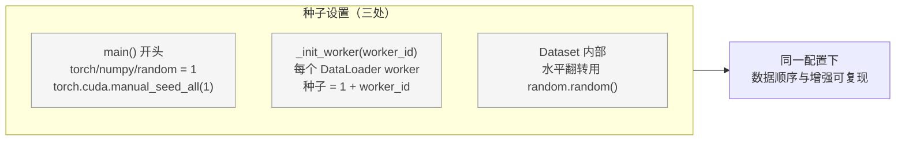

# 04 · 训练回路

对应 `main.py` 的 `main()` / `train()` / `validate()` / `save_checkpoint()`。

## 启动阶段

```mermaid
flowchart TB
    A["python main.py ipnhand RGB<br/>--arch resnet50 --num_segments 8 ..."] --> B["parser.parse_args()"]
    B --> C["设置全局随机种子<br/>torch / cuda / numpy / random = 1"]
    C --> D["dataset_config.return_dataset('ipnhand', 'RGB')<br/>→ num_class=13, 训练/验证标注路径,<br/>root_path, prefix='{:06d}.jpg'"]
    D --> E["拼接 store_name<br/>TSQ_ipnhand_RGB_resnet50_shift0.5_<br/>blockres_avg_segment8_e50"]
    E --> F["打印全部超参"]
    F --> G["check_rootfolders()<br/>创建 log/ 与 checkpoint/ 子目录"]
    G --> H["构建 TSN 模型<br/>is_shift=True, shift_div=0.5,<br/>shift_place='blockres', temporal_pool=False"]
    H --> I["读取 crop_size / scale_size /<br/>input_mean / input_std<br/>get_optim_policies() 参数分组"]
    I --> J["DataParallel(model, device_ids).cuda()"]
    J --> K["summary(model, (24, 224, 224))<br/>打印结构与参数量"]
    K --> L["SGD(policies, lr=0.01, momentum=0.9,<br/>weight_decay=1e-4)"]
    L --> M{"args.resume?"}
    M -->|是| N["load_checkpoint(resume)<br/>恢复 epoch / best_prec1 /<br/>state_dict / optimizer"]
    M -->|否| O["跳过"]
    N --> P{"args.tune_from?"}
    O --> P
    P -->|是| Q["加载预训练权重<br/>处理 .net 前后缀 / 剔除 fc"]
    P -->|否| R["跳过"]
    Q --> S["cudnn.benchmark = True"]
    R --> S
    S --> T["构建 Dataset / DataLoader<br/>见 docs/02"]
    T --> U{"args.evaluate?"}
    U -->|是| V["只跑 validate 后返回"]
    U -->|否| W["打开 log.csv / args.txt<br/>创建 SummaryWriter"]
    W --> X["进入 epoch 循环"]

    classDef init fill:#e3f2fd,stroke:#1565c0,color:#0d47a1
    classDef ckpt fill:#fff4e5,stroke:#ef6c00,color:#e65100
    class H,J,K,L init
    class N,Q ckpt
```

## epoch 循环

### 学习率调度

`adjust_learning_rate` 是 `step` 策略（`--lr_type` 默认 `step`）：

注意 `lr_mult` 是**乘上去**的：分类头的 `lr_mult=5`，
所以 `new_fc` 在第 1 阶段实际用 `0.01 × 5 = 0.05`。

## 单个 batch 的回路

`train_loader` 与 `val_loader` 的差异（采样、增强、shuffle）见
[docs/02](02-data-loading.md#dataloader-组装)。

## 类别均衡采样

这是本仓库相对上游 TSM 的改动之一，解决 IPN-Hand 的**类别不均衡**问题
（如「双指双击」样本远少于「单指点击」）：

实现细节：

- `num_samples = len(dataset)`：一个 epoch 仍走一遍与原数据集等量的样本，
  只是构成变了（稀有类被重复采样、常见类被少采）。
- `replacement=True`：有放回抽样，稀有类才能被反复取到。
- 与 `shuffle=True` **互斥** —— 传了 `sampler` 就不能再传 `shuffle`。

## 产出物与存档

`state` 里存了 5 个键，评测阶段会用到：

| 键 | 用途 |
|---|---|
| `epoch` | resume 时恢复 `args.start_epoch` |
| `arch` | 记录骨干网络名 |
| `state_dict` | 权重本体，`test_models.py` 主要用它 |
| `optimizer` | resume 时恢复动量等状态 |
| `best_prec1` | resume 时恢复最优记录，避免覆盖更好的模型 |

> ⚠️ `checkpoint/` 体积大（单文件数百 MB），已在 `.gitignore` 中排除，
> 需要 scp/rsync 单独传输。

## 日志与可复现性

需要注意的**不可复现因素**（不影响使用，但做对照实验时要留意）：

- `cudnn.benchmark = True`：cuDNN 会自动选最快卷积算法，不同运行可能选到不同算法，
  浮点累加顺序随之变化。
- 多卡 DataParallel 的梯度归约顺序。
- `WeightedRandomSampler` 的抽样依赖全局随机状态。

追求严格复现时可设 `cudnn.benchmark = False` 并固定 `cudnn.deterministic = True`。
