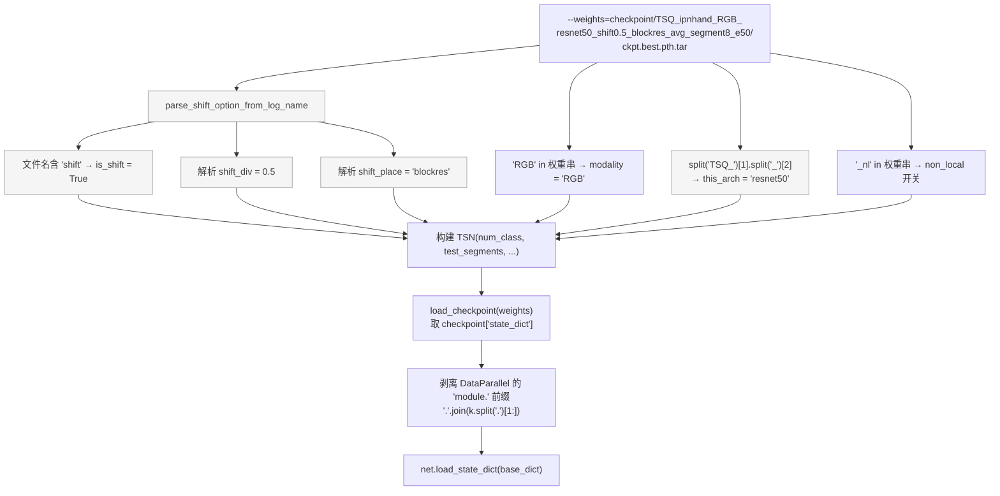
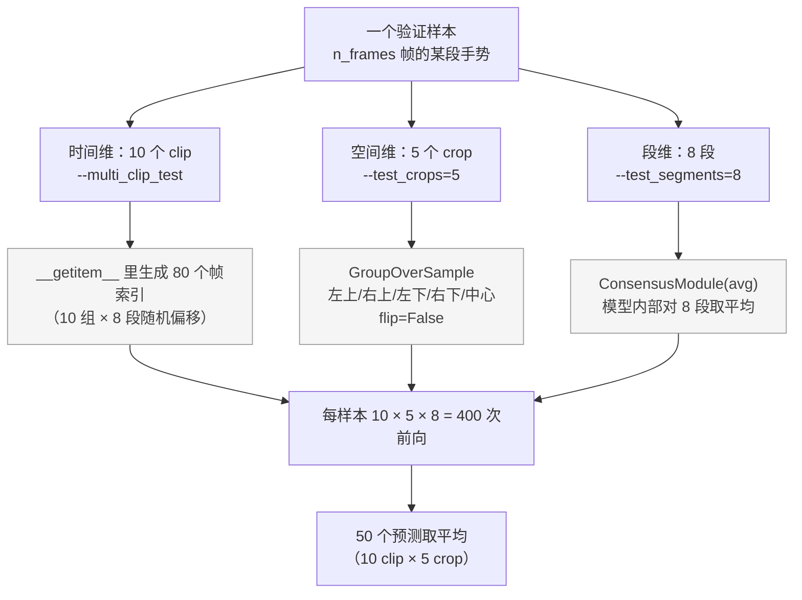
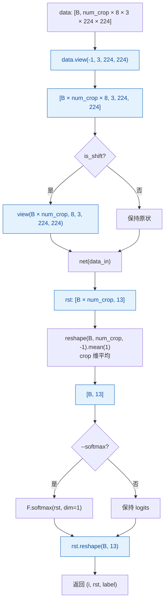
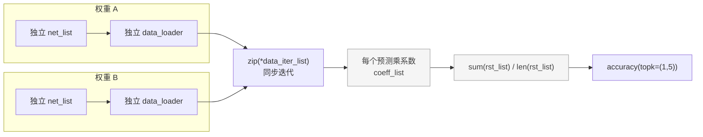
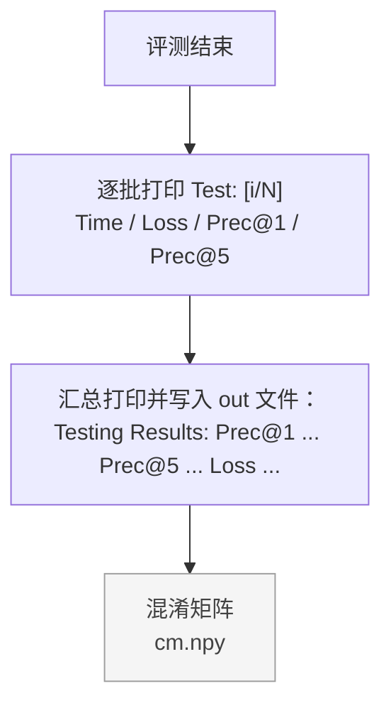

# 05 · 评测流程

对应 `test_models.py`。本仓库的评测脚本使用
`--test_segments=8 --test_crops=5 --multi_clip_test`，
即 **8 段 × 5 crop × 10 clip = 每个样本 400 次前向**，再对 50 个预测取平均。

## 从权重文件名反解网络结构

`test_models.py` 不接收架构参数，而是**从权重路径的字符串里解析**：



> ⚠️ **这是评测链路最脆弱的一环**：文件名必须严格符合
> `TSQ_<数据集>_<模态>_<骨干>_shift<div>_<place>_<共识>_segment<N>_e<轮数>` 的格式。
> 重命名权重文件、或改成别的目录结构，都会让解析失败或解析出错误的 `shift_div`
> —— 而 `shift_div` 错了，权重加载会因形状不匹配而报错（这还算好的；
> 若只是 `shift_place` 解析错，可能加载成功但语义不一致）。
> 训练时 `args.store_name` 就是按这个格式拼的，所以只要权重是训练脚本产出的就安全。

## 两种集成维度



三者的分工：

| 维度 | 参数 | 处理位置 | 作用 |
|---|---|---|---|
| 段（时间） | `--test_segments=8` | **模型内部** `ConsensusModule` | 8 段特征平均，模型输出即 1 个预测 |
| clip（时间） | `--multi_clip_test` | **Dataset** `__getitem__` | 10 组不同的时间偏移，抵消采样随机性 |
| crop（空间） | `--test_crops=5` | **变换链** `GroupOverSample` | 5 个位置裁剪，抵消空间裁剪偏差 |

## 集成计算的位置



要点：`num_crop` 是**累乘**出来的，不是直接等于 `--test_crops`：

```python
num_crop = args.test_crops          # 5
if args.dense_sample: num_crop *= 10
if args.twice_sample: num_crop *= 2
if args.multi_clip_test: num_crop *= 10   # → 50
```

这解释了为什么 8 段是被折进 `num_crop` 之外的维度：
`data` 里每个 clip 就已经含 8 段 × 3 通道 = 24 个通道，
`view(B × num_crop, 8, 3, 224, 224)` 只是把 24 通道重新解释成 `8 × 3`。

## 多权重集成

`test_models.py` 支持一次评测多个权重并加权融合
（`--weights=a.pth,b.pth --test_segments=8,16 --coeff=1,0.5`）：



本仓库脚本只用单个权重，所以 `zip` 里只循环一次，等价于直接取 `rst[1]`。

## 输出



`scripts/test_tsq_ipnhand_rgb_8f.sh` 把 stdout 重定向到 `ipnhand_dete_test.out`，
所以最终数字通过 `tail -n 30 ipnhand_dete_test.out` 查看。

`cm.npy`（混淆矩阵）已在 `.gitignore` 中排除。README 的「性能表现」表格里应填写的
`Overall Prec@1` / `Overall Prec@5` 就取自这个输出文件。

## 与训练内验证的差异

训练时的 `validate()`（`main.py`）与 `test_models.py` 不是同一套流程：

| | `main.py` 的 `validate()` | `test_models.py` |
|---|---|---|
| 采样 | `_get_val_indices` 居中采样（1 组） | 10 组随机 clip |
| 空间 | 单次 `GroupCenterCrop` | 5 crop 过采样 |
| 增强 | `GroupNormalize` | 同 |
| 融合 | 仅 8 段 avg | 8 段 avg → 50 预测再平均 |
| 用途 | 每轮选 best 模型 | 最终报告数字 |

因此**测试脚本报出的数字通常略高于训练日志里的 Best Prec@1**，
两者不可直接比较。README 中的性能表建议统一以测试脚本为准。
