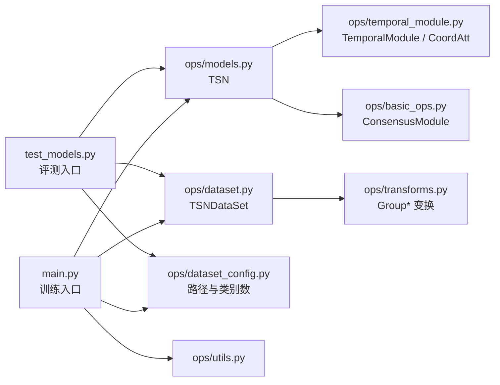

# API 参考（函数与类详解）

逐文件说明每个类、函数的作用、参数与注意事项。
与 [数据流图](README.md) 互补：那边讲**数据怎么流动**，这边讲**代码里有什么**。

## 按文件查找

| 文件 | 行数 | 文档 | 主要内容 |
|---|---|---|---|
| `main.py` | 454 | [main.md](main.md) | 训练 / 验证入口、epoch 循环、存档 |
| `test_models.py` | 347 | [test-models.md](test-models.md) | 评测入口、多 clip × 多 crop 集成 |
| `opts.py` | 76 | [opts.md](opts.md) | 全部命令行参数 |
| `ops/dataset.py` | 341 | [ops-dataset.md](ops-dataset.md) | 标注解析、采样、水平翻转 |
| `ops/models.py` | 403 | [ops-models.md](ops-models.md) | TSN 模型组装、参数分组 |
| `ops/temporal_module.py` | 408 | [ops-temporal-module.md](ops-temporal-module.md) | CoordAtt、时序模块 |
| `ops/transforms.py` | 395 | [ops-transforms.md](ops-transforms.md) | 全部数据增强变换 |
| `ops/dataset_config.py` | 162 | [ops-dataset-config.md](ops-dataset-config.md) | 数据集路径与类别数注册表 |
| `ops/utils.py` | 54 | [ops-utils.md](ops-utils.md) | 工具函数 |
| `ops/basic_ops.py` | 37 | [ops-basic-ops.md](ops-basic-ops.md) | 段级共识模块 |
| `ops/non_local.py` | 173 | [ops-non-local.md](ops-non-local.md) | non-local 块（默认未启用） |
| `ops/__init__.py` | 0 | – | 空文件，仅使 `ops` 成为包 |
| `environment.yml` | 47 | [scripts-and-env.md](scripts-and-env.md) | conda 环境定义 |
| `scripts/*.sh` | 88 | [scripts-and-env.md](scripts-and-env.md) | 训练 / 评测启动脚本 |

## 三句话理解整体结构

1. **`main.py` / `test_models.py` 是唯二的可执行入口**，其余都是被导入的模块。
2. **`opts.py` 定义参数，`ops/dataset_config.py` 定义数据在哪、有几类**，两者都由入口读取。
3. **模型的实际改动点在 `ops/temporal_module.py`**：`TemporalModule` 替换 ResNet 的 `conv1`，
   内部用 `CoordAtt` 做时序注意力 + 动态卷积核。

## 本仓库相对上游 TSM 的改动点

读代码时重点关注这些地方（在对应文档里都有标注）：

| 位置 | 改动 |
|---|---|
| `ops/dataset.py` → `_find_lr_pair`、`get` | 新增：水平翻转时自动对调左右方向类标签 |
| `ops/temporal_module.py` → `CoordAtt` | 改造：动态生成 3×3 空间卷积核，取代固定深度可分离卷积 |
| `ops/temporal_module.py` → `h_list` | 新增：各插入点特征图高度表 |
| `ops/temporal_module.py` → `make_temporal_module` | 新增：重置全局计数器 `TemporalModule.count` |
| `ops/temporal_module.py` → `SpatialAttention` | 新增：空间注意力分支 |
| `ops/transforms.py` → `GroupColorJitter` | 新增：组内共享参数的亮度/对比度抖动 |
| `ops/utils.py` → `load_checkpoint` | 新增：兼容 torch >= 2.6 的 `weights_only` 默认值变化 |
| `main.py` → `_init_worker`、`WeightedRandomSampler` | 新增：类别均衡采样 + 每 worker 随机种子 |

## 阅读建议

- **想改模型结构** → [ops-temporal-module.md](ops-temporal-module.md)，注意 `h_list` 需要同步维护
- **想换数据集** → [ops-dataset-config.md](ops-dataset-config.md) + [ops-dataset.md](ops-dataset.md)
- **想调数据增强** → [ops-transforms.md](ops-transforms.md)，注意 `Group*` 前缀的含义
- **想改训练策略** → [main.md](main.md)（采样、损失、学习率）+ [opts.md](opts.md)
- **想排查精度问题** → [test-models.md](test-models.md)（评测口径与训练内验证不同）
