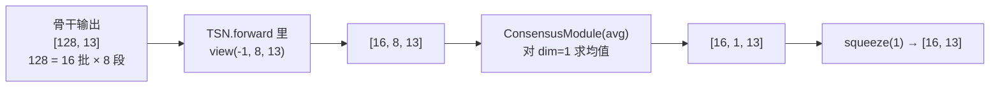

# `ops/basic_ops.py` — 段级共识模块

37 行。整个文件只做一件事：**把 8 段的预测融合成 1 个**。

```python
from ops.basic_ops import ConsensusModule
```

## 数据流位置



---

## `class Identity(torch.nn.Module)`

```python
def forward(self, input): return input
```

直通模块，不做任何处理。**在本文件中没有被使用** —— 属于上游遗留
（原本用于 `consensus_type='rnn'` 的分支）。

---

## `class SegmentConsensus(torch.nn.Module)`

**实际执行融合的模块。**

### `__init__(consensus_type, dim=1)`

| 参数 | 说明 |
|---|---|
| `consensus_type` | `'avg'` 或 `'identity'` |
| `dim` | 沿哪个维度融合，默认 1（即段维） |

### `forward(input_tensor)`

```python
self.shape = input_tensor.size()          # 记录输入形状（副作用，非必需）
if self.consensus_type == 'avg':
    output = input_tensor.mean(dim=self.dim, keepdim=True)
elif self.consensus_type == 'identity':
    output = input_tensor
else:
    output = None
return output
```

| 模式 | 行为 | 输出形状（输入 `[16, 8, 13]`） |
|---|---|---|
| `'avg'` | 段间取均值，`keepdim=True` 保留维度 | `[16, 1, 13]` |
| `'identity'` | 原样返回 | `[16, 8, 13]` |
| 其它值 | **返回 `None`** | – |

**本仓库用 `'avg'`**（训练脚本传 `--consensus_type=avg`）。

两个注意点：

- `keepdim=True` 是必要的 —— `TSN.forward` 紧接着调用 `output.squeeze(1)`，
  依赖维度 1 长度为 1。若改成 `keepdim=False`，`squeeze(1)` 会挤掉类别维而非段维。
- **未知类型静默返回 `None`**，不抛异常。若命令行传错 `--consensus_type`，
  报错会出现在后续的 `squeeze` 处（`AttributeError: 'NoneType'`），
  而不是这里 —— 排查时往回找一层。

---

## `class ConsensusModule(torch.nn.Module)`

**对外的包装类**，`TSN.__init__` 创建的就是它。

### `__init__(consensus_type, dim=1)`

```python
self.consensus_type = consensus_type if consensus_type != 'rnn' else 'identity'
self.dim = dim
```

注意这行：`'rnn'` 会被**静默改写成 `'identity'`**（上游为兼容 RNN 共识保留的映射）。

### `forward(input)`

```python
return SegmentConsensus(self.consensus_type, self.dim)(input)
```

每次前向都**新建一个 `SegmentConsensus` 实例**。因为没有可学习参数，
这样写不影响正确性，但有轻微的对象创建开销（每 batch 一次，可忽略）。

---

## 替换为其它融合方式

若要换融合策略（如加权平均、注意力池化），改 `SegmentConsensus.forward` 的分支即可：

```python
elif self.consensus_type == 'attention':
    # 例如加权求和
    output = (input_tensor * weights).sum(dim=self.dim, keepdim=True)
```

同时需要在 `opts.py` 的 `--consensus_type` 里放开取值限制（当前用 `type=str`，无 choices 限制，
所以命令行可直接传新值）。

> ⚠️ 注意 `--consensus_type` 参与 `store_name` 的拼接，也会写进权重文件名。
> 而 `test_models.py` 是**从文件名反解结构**的（见 [test-models.md](test-models.md)），
> 换了融合方式后评测同样要显式指定 `--crop_fusion_type`，且旧权重不再兼容。
