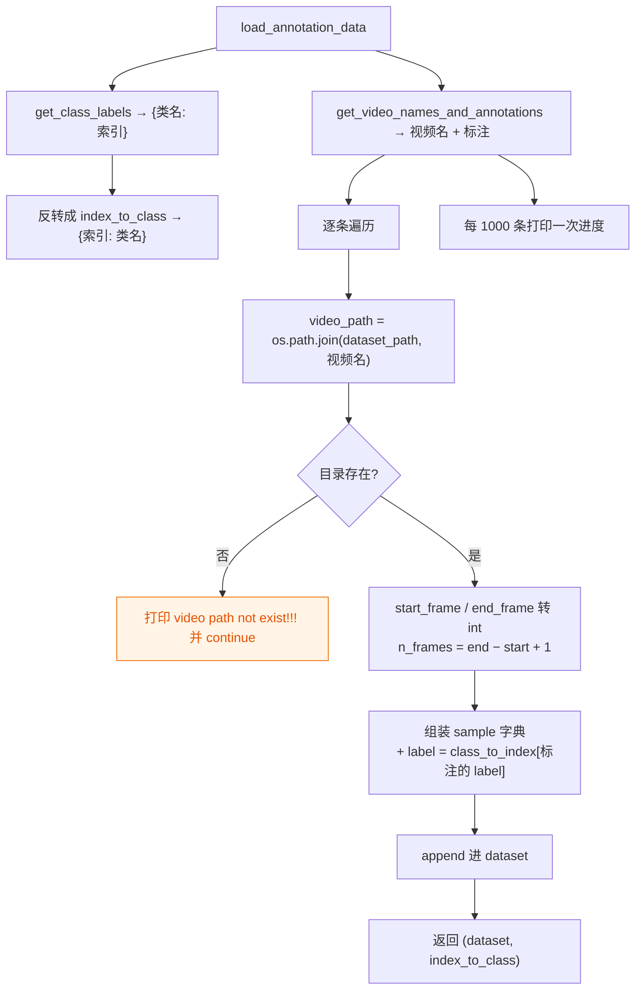

# `ops/dataset.py` — 数据加载

341 行。把 IPN-Hand 的 JSON 标注变成 `(张量, 标签)` 样本。

```python
from ops.dataset import TSNDataSet
```

## 模块级函数

### `load_annotation_data(annotation_path)`

```python
with open(annotation_path, "r") as data_file:
    return json.load(data_file)
```

打开并解析标注 JSON。无异常处理 —— 路径错误会直接抛 `FileNotFoundError`。

### `get_class_labels(data)`

把 JSON 的 `labels` 列表转成 `{类名: 索引}` 映射，索引按列表顺序从 0 递增。

IPN-Hand 配置 `filename_categories = 13`，因此得到 0–12 共 13 个类。

### `get_video_names_and_annotations(data)`

遍历 `data["database"]`，抽出视频名与标注。

```python
subset = next(iter(data["database"].values()))["subset"]
for key, value in data["database"].items():
    video_names.append(key.split("^")[0])   # ipnhand 用 ^ 分隔
    annotations.append(value["annotations"])
```

**关键点**：`key.split("^")[0]`。不同数据集的 key 格式不同，此处保留了三行被注释的写法：

| 数据集 | 分隔符 |
|---|---|
| ego | `_` |
| hci | `^` |
| **ipnhand（本仓库）** | `^` |

**返回**：`(video_names, annotations, subset)`，`subset` 用于打印 `"training dataset is loading..."`。

### `make_dataset(dataset_path, annotation_path)`

**核心函数**：把标注转成样本列表。流程：



**参数**：

| 参数 | 说明 |
|---|---|
| `dataset_path` | 帧数据的根目录（即 `root_path`） |
| `annotation_path` | JSON 标注文件路径 |

**返回**：`(dataset, index_to_class)`

- `dataset` — 样本字典列表，字段见下表
- `index_to_class` — `{索引: 类名}`，在 `TSNDataSet` 里被命名为 `class_names`

**样本字典字段**：

| 字段 | 类型 | 含义 |
|---|---|---|
| `video_path` | str | 该段手势的帧目录绝对路径 |
| `segment` | list | `[start_frame, end_frame]` |
| `start_frame` | int | 起始帧号 |
| `end_frame` | int | 结束帧号 |
| `n_frames` | int | `end − start + 1` |
| `video_id` | int | 在 dataset 中的序号 |
| `label` | int | 类别索引 |
| `frame_indices` | list | `range(start, end+1)` |

> ⚠️ **数据路径不匹配的表现**：目录不存在时**只打印一行警告并跳过**，不报错。
> 如果训练时看到满屏 `video path not exist!!!`，说明
> `ops/dataset_config.py` 的 `ROOT_DATASET` 配错了，此时 dataset 会静默变小、
> 类别可能缺失，训练结果无意义。这是排查数据问题最先要看的一行。

> `start_frame` / `end_frame` 用 `int(float(...))` 转换 —— JSON 里它们可能是浮点字符串。

---

## `class TSNDataSet(data.Dataset)`

PyTorch `Dataset` 子类。**一次 `__getitem__` 返回一段手势的 8 帧 + 标签。**

### `__init__(...)`

```python
TSNDataSet(root_path, list_file, num_segments=3, new_length=1, modality='RGB',
           image_tmpl='img_{:05d}.jpg', transform=None, random_shift=True,
           test_mode=False, remove_missing=False, multi_clip_test=False,
           dense_sample=False, twice_sample=False)
```

| 参数 | 本仓库取值 | 说明 |
|---|---|---|
| `root_path` | 来自 `dataset_config` | 帧数据根目录 |
| `list_file` | `training.json` / `validation.json` | 标注文件 |
| `num_segments` | **8** | 时序段数 |
| `new_length` | **1**（RGB） | 每段的帧数，RGB 下每段 1 帧 |
| `modality` | **`'RGB'`** | 模态 |
| `image_tmpl` | **`'{:06d}.jpg'`** | 帧文件名模板 |
| `transform` | 见 [ops-transforms.md](ops-transforms.md) | 变换链 |
| `random_shift` | 训练 `True` / 验证 `False` | 是否随机采样 |
| `test_mode` | 训练/验证 `False`，测试 `True` | 是否测试模式 |
| `remove_missing` | 测试时 `True` | 见下方说明 |
| `multi_clip_test` | 测试 `True` | 是否 10 组随机采样 |
| `dense_sample` | 默认 `False` | i3D 式密集采样（每样本 10 clip） |
| `twice_sample` | 默认 `False` | 两倍采样集成 |

**构造时做的事**：

1. `self.data, self.class_names = make_dataset(root_path, list_file)` — 解析标注
2. 若 `modality == 'RGBDiff'`，`new_length += 1`（差分需要多一帧）
3. `self._lr_pair = self._find_lr_pair()` — 识别左右方向类配对
4. 按情况打印翻转是否启用
5. `self._do_hflip = random_shift and not test_mode and _lr_pair is not None`

`remove_missing` 在本文件中**只被存储、未被使用**（上游遗留参数，原本用于过滤帧数不足的样本）。

### `_load_image(directory, idx)`

按帧号读一张图，返回**单元素列表**（为兼容 Flow 模态的双通道返回）。

```python
Image.open(os.path.join(self.root_path, directory, self.image_tmpl.format(idx))).convert('RGB')
```

**失败回退**：读不到时打印 `error loading image: <路径>`，然后**返回第 1 帧**。
所以缺帧不会中断训练，但会引入重复帧 —— 长训练中留意这行日志。

`Flow` 分支已被整体注释掉（本仓库只支持 RGB）。

### `_sample_indices(record)` — 训练集随机采样

**返回**：`np.array`，长度 `num_segments`，元素是**绝对帧号**（已加 `start_frame`）。

| 情况 | 行为 |
|---|---|
| `dense_sample=True` | i3D 式：从 `n_frames − 64` 里随机挑起点，按 `64 // num_segments` 步长取 |
| `average_duration > 0` | 每段在 `[段号×平均时长, +平均时长)` 内随机偏移 |
| `n_frames > num_segments` | `randint` 后排序 |
| 都不满足 | 全 0（退化为首帧复制） |

非 dense 分支的核心：

```python
average_duration = (record['n_frames'] - self.new_length + 1) // self.num_segments
offsets = np.multiply(range(self.num_segments), average_duration) + randint(average_duration, size=...)
return offsets + record['start_frame']
```

### `_get_val_indices(record)` — 验证集居中采样

```python
tick = (record['n_frames'] - self.new_length + 1) / float(self.num_segments)
offsets = np.array([int(tick / 2.0 + tick * x) for x in range(self.num_segments)])
```

取每段的中点，**确定性**，便于轮间比较。

### `_get_test_indices(record)` — 测试集采样

三个分支：`dense_sample`（10 个起点）、`twice_sample`（两倍偏移）、默认（同验证集的居中采样）。

### `__getitem__(index)`

```python
record = self.data[index]
if not self.test_mode:
    segment_indices = self._sample_indices(record) if self.random_shift else self._get_val_indices(record)
else:
    if self.multi_clip_test:
        n = ((record['n_frames'] + self.num_segments - 1) // self.num_segments) * self.num_segments
        average_duration = n // self.num_segments
        offsets_list = []
        for _ in range(10):
            offsets = np.multiply(range(self.num_segments), average_duration) + randint(average_duration, size=...)
            offsets_list.append(offsets)
        offsets = np.concatenate(offsets_list)                          # 10 × 8 = 80 个索引
        segment_indices = offsets * record['n_frames'] // n + record['start_frame']
    else:
        segment_indices = self._get_test_indices(record)
return self.get(record, segment_indices)
```

`multi_clip_test` 分支把 `n_frames` **向上取整到 `num_segments` 的整数倍**再均分，
避免最后一段越界；随后重复 10 次随机偏移并拼接，得到 80 个帧索引。

> 原代码中 `if not self.test_mode:` 之后有一段旧实现被注释保留（第 300–303 行），
> 与现在的 `if/else` 等价。

### `_find_lr_pair()` ⭐ 本仓库新增

自动识别「向左 / 向右」两个类别，供水平翻转时对调标签。

```python
names = self.class_names            # {索引: 类名}
idxs = []
for i, nm in names.items():
    low = (nm or '').lower()
    if 'left' in low or 'right' in low or low in ('g05', 'g06'):
        idxs.append(i)
return (idxs[0], idxs[1]) if len(idxs) == 2 else None
```

| 返回 | 含义 |
|---|---|
| `(左类索引, 右类索引)` | 识别成功，启用翻转 |
| `None` | 识别不到（`class_names` 为空、或匹配数 ≠ 2），**关闭翻转** |

**设计原则：宁可完全不翻转，也不翻转错标签。**

镜像会让「向右」看起来像「向左」。若只翻图像不改标签，就产生**静默的错误监督**
（loss 正常下降，只有方向类准确率上不去）。所以严格限定「恰好两个类匹配」才启用。

**如果要适配别的数据集**：类名规则在此函数的 `if` 条件里，按实际类名补充即可。

### `get(record, indices)`

按索引取帧、做变换、执行翻转。**`__getitem__` 的实际执行体。**

```python
images = list()
for seg_ind in indices:
    p = int(seg_ind)
    for i in range(self.new_length):          # RGB 时只循环 1 次
        seg_imgs = self._load_image(record['video_path'], p)
        images.extend(seg_imgs)
        if p < record['end_frame']:
            p += 1
process_data = self.transform(images)          # → [24, 224, 224]
label = record['label']

if self._do_hflip and random.random() < 0.5:
    process_data = torch.flip(process_data, dims=[-1])      # 最后一次 flip
    if self._lr_pair is not None and label in self._lr_pair:
        label = self._lr_pair[1] if label == self._lr_pair[0] else self._lr_pair[0]
return process_data, label
```

三个要点：

1. `if p < record['end_frame']: p += 1` — 钳制在段内，不越界到下一段手势。
2. `torch.flip(dims=[-1])` — 张量布局 `[C, H, W]`，最后一维是宽度，所以等价水平镜像。
   因为 8 帧已在 `Stack` 里拼成一个张量，**一次 flip 就是 8 帧一起镜像**。
3. **翻转与标签对调必须成对出现** —— 这是本仓库相对上游的关键修正。

### `__len__()`

返回样本数 `len(self.data)`。

---

## 上游被注释掉的遗留代码

文件中保留了较多注释块，理解时可忽略：

| 位置 | 内容 |
|---|---|
| 第 17–31 行 | `VideoRecord` 类（改用 dict 存样本后废弃） |
| 第 153–178 行 | `Flow` 模态的 `_load_image` 实现 |
| 第 180–190 行 | `_parse_list()`（改用 JSON 后废弃） |
| 第 256–278 行 | `__getitem__` 里的路径存在性检查（`make_dataset` 已做） |

## 常见问题

| 现象 | 原因 |
|---|---|
| 满屏 `video path not exist!!!` | `ROOT_DATASET` 配错，样本被静默跳过 |
| `error loading image` | 帧缺失，已回退到第 1 帧 |
| 训练日志出现 `WARNING: 无法自动识别"左右方向"类别配对` | `_find_lr_pair` 未匹配到 2 个类，翻转已关闭（安全） |
| 训练日志出现 `=> 训练水平翻转已启用` | 翻转生效，标签对调同时生效 |
