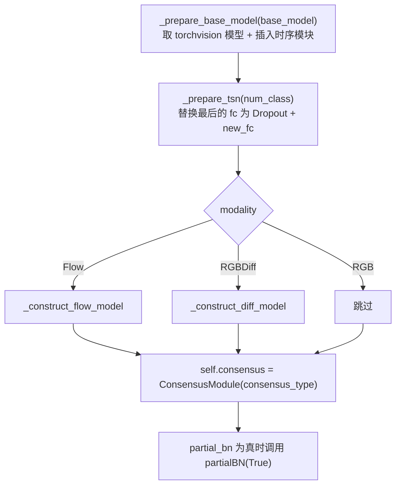

# `ops/models.py` — TSN 模型组装

403 行。核心是 `class TSN`：把 torchvision 的 ResNet 改造成「2D 卷积 + 时序模块」的视频模型。

```python
from ops.models import TSN
```

---

## `class TSN(nn.Module)`

### `__init__(...)`

```python
TSN(num_class, num_segments, modality, base_model='resnet101', new_length=None,
    consensus_type='avg', before_softmax=True, dropout=0.8, img_feature_dim=256,
    crop_num=1, partial_bn=True, print_spec=True, pretrain='imagenet',
    is_shift=False, shift_div=8, shift_place='blockres', fc_lr5=False,
    temporal_pool=False, non_local=False)
```

| 参数 | 本仓库取值 | 说明 |
|---|---|---|
| `num_class` | **13** | 类别数，来自 `dataset_config` |
| `num_segments` | **8** | 时序段数 |
| `modality` | **`'RGB'`** | 模态，决定 `new_length` 与输入通道数 |
| `base_model` | **`'resnet50'`** | 骨干名，按字符串 `getattr(torchvision.models, ...)` |
| `new_length` | `None` → 自动（RGB 为 1） | 每段帧数 |
| `consensus_type` | **`'avg'`** | 段间融合方式 |
| `before_softmax` | `True` | 是否在融合前不过 softmax |
| `dropout` | **0.5** | 分类头前的 dropout |
| `partial_bn` | **`False`**（脚本传 `--npb`） | 是否冻结除首个外的 BN |
| `pretrain` | `'imagenet'` | 预训练来源 |
| `is_shift` | **`True`** | 是否插入时序模块 |
| `shift_div` | **`0.50`** | 参与时序建模的通道比例 |
| `shift_place` | **`'blockres'`** | 插入位置策略 |
| `fc_lr5` | 由 `main.py` 推导 | 分类头是否用 5 倍学习率 |
| `temporal_pool` | `False` | 是否启用时序池化 |
| `non_local` | `0`（关闭） | non-local 块数量 |

**构造顺序（改代码时必须理解）**：



**顺序很重要**：`_prepare_base_model` 先跑（插入时序模块），`_prepare_tsn` 后跑（改分类头）。
若反过来，`get_optim_policies` 会把新插入的模块参数归类错误。

**属性**：`input_size = 224`、`input_mean = [0.485, 0.456, 0.406]`、`input_std = [0.229, 0.224, 0.225]`
（ImageNet 统计量），以及 `last_layer_name = 'fc'`。

### `_prepare_tsn(num_class)`

把骨干的最后一层换成分类头，返回 `feature_dim`（ResNet-50 为 2048）。

```python
if self.dropout == 0:
    setattr(base_model, 'fc', nn.Linear(feature_dim, num_class))
else:
    setattr(base_model, 'fc', nn.Dropout(p=self.dropout))
    self.new_fc = nn.Linear(feature_dim, num_class)
```

**注意**：`dropout > 0` 时 `base_model.fc` 被改成 **Dropout 层**，真正的分类器是 `self.new_fc`。
这解释了 `test_models.py` 加载权重时的替换逻辑：

```python
replace_dict = {'base_model.classifier.weight': 'new_fc.weight', ...}
```

权重初始化用 `normal_(std=0.001)` + `constant_(0)`，是新层专用的初始化尺度。

### `_prepare_base_model(base_model)`

按骨干名从 torchvision 取模型，并注入时序模块与 non-local 块。

```python
if 'resnet' in base_model:
    self.base_model = getattr(torchvision.models, base_model)(weights=torchvision.models.ResNet50_Weights.DEFAULT)
    if self.is_shift:
        make_temporal_module(self.base_model, self.num_segments,
                             n_div=self.shift_div, place=self.shift_place, temporal_pool=self.temporal_pool)
    if self.non_local:
        make_non_local(self.base_model, self.num_segments)
    self.base_model.last_layer_name = 'fc'
```

**两处硬编码需要注意**：

1. **`ResNet50_Weights.DEFAULT` 写死**：无论 `--arch` 传什么 ResNet 变体，都用 ResNet-50 的
   预训练权重枚举。本仓库固定 `--arch resnet50`，所以没问题；换 `resnet101` 会取错权重枚举。
2. **`BNInception` / `InceptionV3` 分支已被注释掉**，只支持 ResNet 系。
   `--arch` 传其它值会走到 `raise ValueError('Unknown base model: ...')`。

> `non_local` 若开启，`make_non_local` 会 `import archs`（不存在的模块）而报错，
> 详见 [ops-non-local.md](ops-non-local.md)。本仓库默认关闭，不受影响。

### `train(mode=True)` — 覆写 PyTorch 的 `train()`

```python
super(TSN, self).train(mode)
count = 0
if self._enable_pbn and mode:
    print("Freezing BatchNorm2D except the first one.")
    for m in self.base_model.modules():
        if isinstance(m, nn.BatchNorm2d):
            count += 1
            if count >= (2 if self._enable_pbn else 1):
                m.eval()
                m.weight.requires_grad = False
                m.bias.requires_grad = False
```

`partial BN` 策略：**冻结除第一个之外的 BN 层**，使其保留 ImageNet 的统计量。
这是小数据集微调的常规做法（防止 BN 统计量被小批量数据带偏）。

**本仓库脚本传了 `--npb`**（`partial_bn=False`），因此 `_enable_pbn` 为假，
**所有 BN 层都参与训练**。这适合 IPN-Hand 这种规模尚可的数据集。

### `partialBN(enable)`

一行 setter：`self._enable_pbn = enable`。`main.py` 每个 epoch 开头会按 `args.no_partialbn` 调用一次。

### `get_optim_policies()`

**把参数分成 9 组，各自设定学习率与权重衰减倍率。** 返回可直接传给 `SGD` 的列表。

| 组名 | 内容 | `lr_mult` | `decay_mult` |
|---|---|---|---|
| `first_conv_weight` | 第 1 个 Conv 的 weight | 1（Flow 为 5） | 1 |
| `first_conv_bias` | 第 1 个 Conv 的 bias | 2（Flow 为 10） | **0** |
| `normal_weight` | 其余 Conv/Linear 的 weight | 1 | 1 |
| `normal_bias` | 其余 bias | 2 | **0** |
| `BN scale/shift` | BatchNorm 参数 | 1 | **0** |
| `GN scale/shift` | GroupNorm 参数 | 1 | **0** |
| `custom_ops` | 预留（恒为空） | 1 | 1 |
| `lr5_weight` | `fc_lr5=True` 时的 `new_fc.weight` | **5** | 1 |
| `lr10_bias` | `fc_lr5=True` 时的 `new_fc.bias` | **10** | **0** |

设计要点：

- **bias 与 BN 不做 weight decay**（`decay_mult=0`）：衰减到 0 会损害表达能力。
- **分类头用 5–10 倍学习率**：`new_fc` 是随机初始化，而骨干是预训练权重。
- 遍历时靠 `isinstance` 识别类型；遇到**未知的原子模块且带参数会主动报错**：

```python
elif len(m._modules) == 0:
    if len(list(m.parameters())) > 0:
        raise ValueError("New atomic module type: {}. Need to give it a learning policy".format(type(m)))
```

> ⚠️ 这条检查是**改动模型时的常见坑**：若你在网络里加了一个新的自定义层（如自定义
> `nn.Module` 且含参数），而它不属于 Conv/Linear/BN/GN，启动训练就会直接报这个错。
> 解决方法是把它的参数归入 `custom_ops` 组。

### `forward(input, no_reshape=False)`

```python
if not no_reshape:
    sample_len = (3 if modality == "RGB" else 2) * self.new_length    # RGB: 3
    if modality == 'RGBDiff':
        sample_len = 3 * self.new_length
        input = self._get_diff(input)
    base_out = self.base_model(input.view((-1, sample_len) + input.size()[-2:]))
else:
    base_out = self.base_model(input)

if self.dropout > 0:
    base_out = self.new_fc(base_out)
if not self.before_softmax:
    base_out = self.softmax(base_out)
if self.reshape:
    base_out = base_out.view((-1, self.num_segments) + base_out.size()[1:])
    output = self.consensus(base_out)
    return output.squeeze(1)
```

**形状流转**（`B=16, S=8`）：

```
input          [16, 24, 224, 224]     ← 24 = 8 段 × 3 通道
view(-1, 3, …) [128, 3, 224, 224]     ← 时间折进批维
base_model     [128, 2048]
new_fc         [128, 13]
view(-1, 8, …) [16, 8, 13]
consensus(avg) [16, 1, 13]
squeeze(1)     [16, 13]               ← 返回值
```

`temporal_pool=True` 时段数按 `num_segments // 2` 还原（因为池化已把时间减半）。

**注意 `if self.reshape:` 没有 else 分支** —— 若 `self.reshape` 为假，函数返回 `None`。
该属性在 `__init__` 里恒为 `True`，所以实际不会触发。

### `_get_diff(input, keep_rgb=False)`

RGBDiff 模态专用：计算帧间差分。

```python
input_view = input.view((-1, self.num_segments, self.new_length + 1, input_c,) + input.size()[2:])
new_data = input_view[:, :, 1:, :, :, :].clone()
for x in reversed(list(range(1, self.new_length + 1))):
    new_data[:, :, x - 1, :, :, :] = input_view[:, :, x] - input_view[:, :, x - 1]
```

**本仓库不用**（模态固定 RGB），保留作兼容。

### `_construct_flow_model(base_model)`

把 ImageNet 预训练的第一个卷积层改成接受 `2 × new_length` 通道（光流 x/y），
方法是对原 3 通道卷积核按通道取均值后 `expand`。

若骨干是 `BNInception`，还会从 Dropbox 下载光流专用权重。
**本仓库不用**（RGB 模态）。

### `_construct_diff_model(base_model, keep_rgb=False)`

同理，把首层卷积改成接受 `3 × new_length` 通道（RGB 差分），支持 `keep_rgb` 保留原始 RGB。
**本仓库不用**。

### 属性 `crop_size` / `scale_size`

```python
@property
def crop_size(self):  return self.input_size              # 224
@property
def scale_size(self): return self.input_size * 256 // 224  # 256
```

标准的「先缩放短边到 256 再裁 224」比例。`main.py` 用它们构建验证/测试的变换链。

### `get_augmentation(flip=True)`

返回训练用的增强链。RGB 分支：

```python
if flip:
    return Compose([GroupMultiScaleCrop(input_size, [1, .875, .75, .66]),
                    GroupRandomHorizontalFlip(is_flow=False)])
else:
    print('#' * 20, 'NO FLIP!!!')
    return Compose([GroupMultiScaleCrop(input_size, [1, .875, .75, .66])])
```

**关键点**：`main.py` 对 `ipnhand` / `jester` / `hcigesture` / `egogesture` 这些**手势数据集
传 `flip=False`**，打印 `NO FLIP!!!`。

原因：TSM 自带的 `GroupRandomHorizontalFlip` 只翻图像**不改标签**，
对含左右方向类的手势数据集会造成错误监督。本仓库改由
`TSNDataSet._find_lr_pair` + `get()` 里带标签对调的翻转负责
（见 [ops-dataset.md](ops-dataset.md#_find_lr_pair-本仓库新增)）。

因此在这份配置下，**训练时的水平翻转来自 Dataset，而不是这里**。

---

## 上游被注释掉的遗留代码

第 121–168 行保留了 `BNInception` / `InceptionV3` 的构建分支（含 `build_temporal_ops` 调用，
属于旧版 TSM 接口）。当前实现只支持 ResNet 系。

## 改动提示

| 想做的事 | 要注意 |
|---|---|
| 换骨干为 resnet101 | `_prepare_base_model` 里预训练权重枚举写死了 `ResNet50_Weights.DEFAULT`，需一并改 |
| 加自定义层 | 必须纳入 `get_optim_policies` 的分组，否则启动报 `New atomic module type` |
| 改 `num_segments` | `main.py` 的 `summary(model, (24, 224, 224))` 与 `ops/temporal_module.py` 的 `h_list` 都需同步 |
| 改输入分辨率 | `h_list` 需要重算，`input_size` 也要改 |
