# `ops/transforms.py` — 数据增强变换

395 行。**所有 `Group*` 前缀的变换都保证「同组帧用完全相同的随机参数」**，
这是视频数据增强与图像增强的根本区别。

```python
from ops.transforms import *      # main.py 与 test_models.py 都是通配导入
```

## 为什么必须用 `Group*`

一段手势的 8 帧如果各自独立随机裁剪/调色，就等于**给时序通道注入噪声**，
破坏运动信息 —— 模型可能学会靠「色彩跳变」而非「手的移动」来分类。

因此本文件用 `Group` 语义重写了一遍 torchvision 的常用变换：

```python
class GroupRandomCrop(object):
    def __call__(self, img_group):
        x1 = random.randint(0, w - tw)     # ← 随机参数在循环外抽一次
        y1 = random.randint(0, h - th)
        for img in img_group:              # ← 组内所有帧共用同一个 (x1, y1)
            out_images.append(img.crop((x1, y1, x1 + tw, y1 + th)))
```

个别变换直接复用了 torchvision 的逐帧实现（如 `GroupCenterCrop` 包装 `CenterCrop`），
因为**中心裁剪本身就是确定性的**，逐帧施加等价于组内同参。

> ⚠️ 例外：`main.py` 里用的 `torchvision.transforms.RandomErasing(p=0.2)` 是**逐帧独立**的。
> 它作用在已归一化的张量上模拟局部遮挡，逐帧独立反而起正则化作用，不破坏运动方向。

---

## 空间裁剪与缩放

### `class GroupRandomCrop(size)`

随机裁剪。`size` 支持单个数字（边长）或 `(w, h)` 元组。
`__init__` 里用 `isinstance(size, numbers.Number)` 判别，转成 `(int(size), int(size))`。

`__call__(img_group)`：抽一组 `(x1, y1)`，对组内每帧施加相同裁剪。
尺寸已相等时直接返回原图（省去一次拷贝）。含 `assert` 检查组内尺寸一致。

### `class GroupCenterCrop(size)`

```python
self.worker = torchvision.transforms.CenterCrop(size)
def __call__(self, img_group):
    return [self.worker(img) for img in img_group]
```

包装 torchvision 的中心裁剪。中心裁剪无随机性，所以逐帧施加等同于组内同参。

**用于**：验证集与测试集的变换链。

### `class GroupRandomHorizontalFlip(is_flow=False)`

镜像翻转。`is_flow=True` 时对奇数帧取反（光流图的水平分量需要反向）。

> ⚠️ **本仓库实际不使用它做训练翻转**。
> `main.py` 对 `ipnhand` 等手势数据集调用 `model.get_augmentation(flip=False)`，
> 因此这条链不会包含本变换。
>
> 原因：它只翻图像**不改标签**，对含「向左/向右」方向类的手势数据集会造成错误监督。
> 正确做法由 [`TSNDataSet._find_lr_pair`](ops-dataset.md#_find_lr_pair-本仓库新增)
> 与 `get()` 里的标签对调实现。

### `class GroupScale(size, interpolation=Image.BILINEAR)`

```python
self.worker = torchvision.transforms.Resize(size, interpolation)
```

把短边缩放到 `size`。标准流程是「缩放到 256 → 裁 224」。

**用于**：验证/测试链、`GroupOverSample` 与 `GroupFullResSample` 内部。

### `class GroupMultiScaleCrop(input_size, scales=None, max_distort=1, fix_crop=True, more_fix_crop=True)`

**训练集的主力裁剪**。多尺度 + 多宽高比随机裁剪，是 TSN 系的标配增强。

| 参数 | 默认 | 说明 |
|---|---|---|
| `input_size` | – | 输出尺寸 |
| `scales` | `[1, .875, .75, .66]` | 候选缩放比例 |
| `max_distort` | 1 | 允许的宽高比扭曲程度 |
| `fix_crop` | `True` | 是否从固定 13 个位置里选（否则完全随机） |
| `more_fix_crop` | `True` | 是否启用 13 个位置（否则只用 5 个） |

**三个方法**：

| 方法 | 作用 |
|---|---|
| `__call__(img_group)` | 采样裁剪框 → 裁剪所有帧 → resize 到 `input_size` |
| `_sample_crop_size(im_size)` | 从 `scales` 两两组合中筛选满足 `max_distort` 的尺寸对，随机选一对并定偏移 |
| `_sample_fix_offset(...)` | 从 `fill_fix_offset` 给出的一组偏移里随机选一个 |
| `fill_fix_offset(...)`（`@staticmethod`） | 生成固定偏移集合 |

`fill_fix_offset` 给出 5 个基础位置（四角 + 中心），
`more_fix_crop=True` 时再补 8 个（四边中点 + 四个四分点），共 **13 个位置**：

```python
ret.append((0, 0))                        # upper left
ret.append((4*w_step, 0))                 # upper right
ret.append((0, 4*h_step))                 # lower left
ret.append((4*w_step, 4*h_step))          # lower right
ret.append((2*w_step, 2*h_step))          # center
if more_fix_crop:
    ...  # 另有 8 个
```

> `fill_fix_offset` 被 `GroupOverSample` 复用（传 `more_fix_crop=False`），
> 因此它虽然是「私有」风格的静态方法，实际是跨类的公共工具。

### `class GroupRandomSizedCrop(size, interpolation=Image.BILINEAR)`

Inception 风格的随机尺寸裁剪：面积比例取原图的 0.08–1.0，宽高比在 3/4–4/3 之间随机。
`__call__` 内对每帧用**同一组** `(i, j, h, w)`。

**本仓库未在默认链中使用**，保留作可选增强。

---

## 测试用的多裁剪采样

### `class GroupOverSample(crop_size, scale_size=None, flip=True)`

**本仓库测试脚本使用它**（`--test_crops=5`，`flip=False`）。

```python
def __call__(self, img_group):
    if self.scale_worker is not None:
        img_group = self.scale_worker(img_group)          # GroupScale
    offsets = GroupMultiScaleCrop.fill_fix_offset(False, image_w, image_h, crop_w, crop_h)
    for o_w, o_h in offsets:                              # 5 个位置
        for i, img in enumerate(img_group):
            crop = img.crop((o_w, o_h, o_w + crop_w, o_h + crop_h))
            normal_group.append(crop)
            flip_crop = crop.copy().transpose(Image.FLIP_LEFT_RIGHT)
            ...
        oversample_group.extend(normal_group)
        if self.flip:
            oversample_group.extend(flip_group)           # ← flip=False 时不追加
    return oversample_group
```

**输出数量**：`5 个位置 × (1 + flip)` —— `flip=False` 得 **5 张**，
`flip=True` 得 10 张。与 `--test_crops 5` / `10` 对应。

`fill_fix_offset(False, ...)` 的第一个参数 `more_fix_crop=False`，
所以只用 5 个位置（四角 + 中心），正好匹配 `test_crops=5`。

灰度图（`mode == 'L'`）且为偶数帧时，翻转后需要 `ImageOps.invert` 反相 ——
这是光流图翻转的正确处理方式（水平分量方向相反）。

### `class GroupFullResSample(crop_size, scale_size=None, flip=True)`

与 `GroupOverSample` 类似的 3 裁剪版本，用于 `--test_crops=3`：

```python
offsets.append((0 * w_step, 2 * h_step))  # left
offsets.append((4 * w_step, 2 * h_step))  # right
offsets.append((2 * w_step, 2 * h_step))  # center
```

**注意一处不一致**：它的 `__call__` 末尾是

```python
oversample_group.extend(normal_group)
oversample_group.extend(flip_group)      # ← 没有 if self.flip 判断
```

`flip=False` 时 `flip_group` 是空列表，`extend` 无效果，所以**行为仍正确**（得 3 张）；
但与 `GroupOverSample` 的写法不对称，且每次循环都做一次空 extend。属于上游遗留的写法差异。

---

## 归一化与张量化

### `class GroupNormalize(mean, std)`

```python
def __call__(self, tensor):        # tensor: [C, H, W]，C = 3 × 帧数
    for t, m, s in zip(tensor, self.repeated_mean, self.repeated_std):
        t.sub_(m).div_(s)
```

按通道做 `(x - mean) / std` 的**原地**归一化。
`mean` / `std` 会在 `__init__` 里按通道数重复展开，以匹配 `3 × 帧数` 的通道维。

**注意**：输入是**已 Stack 并转成张量**的数据（`[24, 224, 224]`），
所以它必须排在 `ToTorchFormatTensor` **之后**。

### `class Stack(roll=False)`

把一组 PIL 图沿**通道维**拼接：

```python
if img_group[0].mode == 'L':
    return np.concatenate([np.expand_dims(x, 2) for x in img_group], axis=2)
elif img_group[0].mode == 'RGB':
    if self.roll:
        return np.concatenate([np.array(x)[:, :, ::-1] for x in img_group], axis=2)
    else:
        return np.concatenate(img_group, axis=2)
```

**输出**：`[H, W, 3 × 帧数]`，即 8 帧 RGB → `[H, W, 24]`。
这就是「时间被折进通道维」的关键一步。

`roll=True`（BNInception / InceptionV3 用）会做 RGB→BGR 通道反转，
因为那两个模型用 Caffe 风格输入顺序。**本仓库用 ResNet，`roll=False`**。

### `class ToTorchFormatTensor(div=True)`

`[H, W, C]` numpy → `[C, H, W]` torch 张量。

```python
img = torch.from_numpy(pic).permute(2, 0, 1).contiguous()
return img.float().div(255) if self.div else img.float()
```

`div=True` 时把 `[0, 255]` 归一到 `[0.0, 1.0]`。
`div=(args.arch not in ['BNInception', 'InceptionV3'])` —— ResNet 下为 `True`。

### `class IdentityTransform`

直通变换，不做任何处理。`main.py` 里在 `modality == 'RGBDiff'` 时用它替代 `GroupNormalize`
（差分图不需要按 ImageNet 统计量归一化）。

---

## ⭐ `class GroupColorJitter(brightness=0.2, contrast=0.2, saturation=0.0)` 本仓库新增

**组内共享参数的亮度/对比度/饱和度抖动。**

```python
def __call__(self, img_group):
    b = 1.0 + random.uniform(-self.brightness, self.brightness)
    c = 1.0 + random.uniform(-self.contrast, self.contrast)
    s = 1.0 + random.uniform(-self.saturation, self.saturation)
    ret = []
    for img in img_group:
        if self.brightness > 0: img = ImageEnhance.Brightness(img).enhance(b)
        if self.contrast   > 0: img = ImageEnhance.Contrast(img).enhance(c)
        if self.saturation > 0: img = ImageEnhance.Color(img).enhance(s)
        ret.append(img)
    return ret
```

| 参数 | 本仓库取值 | 说明 |
|---|---|---|
| `brightness` | 0.2 | 亮度抖动幅度（±20%） |
| `contrast` | 0.2 | 对比度抖动幅度 |
| `saturation` | 0.0 | 饱和度，默认关闭 |

**为什么不用 torchvision 的 `ColorJitter`**：它是逐帧独立随机的，不满足 group 语义。
本实现把三个随机系数**抽在循环外**，组内 8 帧共用。

**目的**：提升对光照变化与背景差异的鲁棒性 —— 手势数据集常在多变环境下采集。

`main.py` 中的位置：在 `train_augmentation` 之后、`Stack` 之前（作用于 PIL 图）。

---

## 默认变换链

各入口实际组装的链：

```mermaid
flowchart TB
    subgraph TR["训练（main.py）"]
        T1["train_augmentation = get_augmentation(flip=False)<br/>= GroupMultiScaleCrop(224, [1,.875,.75,.66])"]
        T2["GroupColorJitter(0.2, 0.2)"]
        T3["Stack(roll=False)"]
        T4["ToTorchFormatTensor(div=True)"]
        T5["GroupNormalize(ImageNet)"]
        T6["RandomErasing(p=0.2)（逐帧独立）"]
        T1 --> T2 --> T3 --> T4 --> T5 --> T6
    end
    subgraph VA["验证（main.py）"]
        V1["GroupScale(256)"] --> V2["GroupCenterCrop(224)"] --> V3["Stack"] --> V4["ToTorchFormatTensor"] --> V5["GroupNormalize"]
    end
    subgraph TE["测试（test_models.py，test_crops=5）"]
        E1["GroupOverSample(224, 256, flip=False)"] --> E2["Stack"] --> E3["ToTorchFormatTensor"] --> E4["GroupNormalize"]
    end
```



---

## `if __name__ == "__main__":`

文件末尾的自测块：加载 `../tensorflow-model-zoo.torch/lena_299.png`，
分别跑一遍彩色（`GroupScale` + `GroupRandomCrop` + `Stack` + `ToTorchFormatTensor` + `GroupNormalize`）
与灰度（`GroupRandomSizedCrop`）流程并打印。

**依赖一张外部测试图片，路径不存在会报错** —— 直接运行本文件仅作开发调试用，
不影响正常训练与评测。
