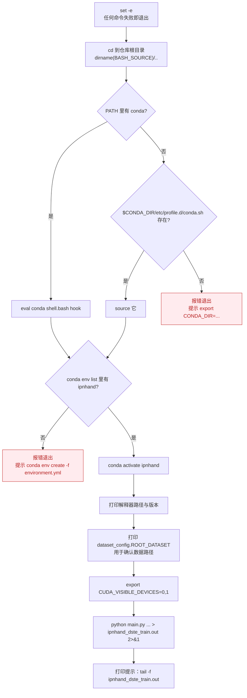

# `scripts/*.sh` 与 `environment.yml`

非 Python 文件：两个启动脚本与 conda 环境定义。**它们是第 2 个提交里被重写的部分**
（原来只有两三行裸命令，现在带环境激活与前置校验）。

---

## `scripts/train_tsq_ipnhand_rgb_8f.sh`（47 行）

### 用法

```bash
bash scripts/train_tsq_ipnhand_rgb_8f.sh
```

### 执行流程



### 三个设计要点

**① `cd "$(dirname "${BASH_SOURCE[0]}")/.."`**

无论从哪个目录调用，都会先切到仓库根目录。这样 `python main.py` 与
`checkpoint/...` 等相对路径才成立 —— 不用手动 `cd`，也不会因路径错误而失败。

**② conda 激活的双重回退**

```bash
CONDA_DIR="${CONDA_DIR:-$HOME/miniconda3}"
if command -v conda >/dev/null 2>&1; then
    eval "$(conda shell.bash hook)"
elif [ -f "$CONDA_DIR/etc/profile.d/conda.sh" ]; then
    source "$CONDA_DIR/etc/profile.d/conda.sh"
else
    echo "[ERROR] ..." >&2; exit 1
fi
```

非交互式 shell（如 `nohup bash script.sh`）里 `conda` 函数通常**未定义**，
所以先试 PATH 中的 `conda` 命令，再回退到 `$CONDA_DIR` 下的初始化脚本。
安装目录不在 `~/miniconda3` 时可用 `export CONDA_DIR=...` 覆盖。

**③ `CUDA_VISIBLE_DEVICES=0,1` 是硬编码**

```bash
# 按服务器实际可用 GPU 调整；若只有 1 张卡可改成 0
export CUDA_VISIBLE_DEVICES=0,1
```

**只有 1 张卡时必须改成 `0`**，否则 PyTorch 初始化时报
「invalid device ordinal」。

### 传给 `main.py` 的参数

```bash
python main.py ipnhand RGB \
     --arch resnet50 --num_segments 8 \
     --gd 20 --lr 0.01 --wd 1e-4 --lr_steps 20 40 --epochs 50 \
     --batch-size 16 -j 32 --dropout 0.5 --consensus_type=avg --eval-freq=1 \
     --shift --shift_div=0.50 --shift_place=blockres --npb > ipnhand_dste_train.out 2>&1
```

各参数含义见 [opts.md](opts.md)。其中 `> ipnhand_dste_train.out 2>&1`
把 stdout 与 stderr 都重定向到日志文件，所以前台运行时**终端看不到输出**，
需要另开一个终端 `tail -f ipnhand_dste_train.out`。

### 推荐的后台运行方式

```bash
nohup bash scripts/train_tsq_ipnhand_rgb_8f.sh > ipnhand_dste_train_console.log 2>&1 &
tail -f ipnhand_dste_train.out
```

`nohup` + `&` 防止 ssh 断连时被挂断信号杀死。
`.*.out` 与 `*.log` 都已在 `.gitignore` 里排除。

---

## `scripts/test_tsq_ipnhand_rgb_8f.sh`（41 行）

结构与训练脚本基本相同（`set -e`、`cd`、conda 激活、路径打印），**差异只有权重路径、参数与输出文件**：

```bash
python test_models.py ipnhand \
    --weights=checkpoint/TSQ_ipnhand_RGB_resnet50_shift0.5_blockres_avg_segment8_e50/ckpt.best.pth.tar \
    --test_segments=8 --test_crops=5 \
    --batch_size=4 -j 32  \
    --multi_clip_test > ipnhand_dete_test.out 2>&1

echo "==> 测试结束。查看结果: tail -n 30 ipnhand_dete_test.out"
```

| 参数 | 值 | 说明 |
|---|---|---|
| `--weights` | `checkpoint/.../ckpt.best.pth.tar` | **相对仓库根目录**，依赖脚本前的 `cd` |
| `--test_segments` | `8` | 必须与训练时的 `--num_segments` 一致 |
| `--test_crops` | `5` | 5 个位置裁剪（四角 + 中心），不翻转 |
| `--batch_size` | `4` | 评测批更小（每样本展开成 50 个 crop，显存占用更大） |
| `--multi_clip_test` | – | 10 组时间采样 |

**权重路径中的 `shift0.5_blockres` 不是装饰** —— `test_models.py` 会从这里
反解网络结构（见 [test-models.md](test-models.md#parse_shift_option_from_log_namelog_name)）。

### 与训练脚本的对比

| | 训练脚本 | 评测脚本 |
|---|---|---|
| 入口 | `main.py` | `test_models.py` |
| 输出文件 | `ipnhand_dste_train.out` | `ipnhand_dete_test.out` |
| `CUDA_VISIBLE_DEVICES` | `0,1` | `0,1` |
| `-j` workers | 32 | 32 |
| 结束提示 | `tail -f`（训练中持续看） | `tail -n 30`（结束后看结果） |

> 评测脚本修改 `CUDA_VISIBLE_DEVICES` 的注意事项与训练脚本相同。

---

## `environment.yml`（48 行）

conda 环境定义，环境名 **`ipnhand`**。

```bash
conda env create -f environment.yml      # 创建
conda env update -f environment.yml      # 更新
conda env remove -n ipnhand              # 删除
```

### 依赖清单

| 依赖 | 版本 | 用途 |
|---|---|---|
| `python` | `3.10` | 与 Ubuntu 22.04 默认一致 |
| `pytorch` | `2.1.2` | 训练框架 |
| `torchvision` | `0.16.2` | ResNet 骨干、预训练权重、部分变换 |
| `pytorch-cuda` | `11.8` | CUDA 运行时 |
| `numpy` | `1.26` | **钉住 1.x**，见下 |
| `pillow` | – | 图像读写（`ops/dataset.py` 用 `PIL.Image`） |
| `scikit-learn` | – | `test_models.py` 的 `confusion_matrix` |
| `tensorboardx` | – | `main.py` 的 `SummaryWriter` |
| `torchsummary`（pip） | – | `main.py` 的 `summary(model, ...)` 打印结构 |

`channels` 顺序：`pytorch` → `nvidia` → `conda-forge` → `defaults`。

### 为什么钉住 `numpy=1.26`

注释写明了原因：**torch 2.1 依赖 numpy 1.x**。
numpy 2.0 有大量 ABI 破坏性变更，与 torch < 2.3 不兼容
（典型报错是 `A module that was compiled using NumPy 1.x cannot be run in NumPy 2.x`）。

若升级 torch 到 2.4+，可以放宽 numpy 限制。

### 显卡驱动适配

脚本注释给出了两条升级/降级路径：

| 服务器情况 | 建议改动 |
|---|---|
| 驱动 >= 525（支持 CUDA 12.x） | 改为 `pytorch=2.4.1` / `torchvision=0.19.1` / `pytorch-cuda=12.1`（或 12.4） |
| 只有 CPU（仅调试） | `pip install torch torchvision --index-url https://download.pytorch.org/whl/cpu` |

> 纯 CPU 环境**无法真正训练** —— `main.py` 里有 `model.cuda()` 与
> `torch.nn.DataParallel(...).cuda()`，只能做代码层面的调试。

### 常见问题

| 现象 | 处理 |
|---|---|
| `torch` import 报 CUDA 驱动错误 | 驱动与 `pytorch-cuda` 版本不匹配，按上表调整后重建环境 |
| 首次运行卡住 / 下载失败 | 需联网下载 ImageNet 预训练权重（缓存到 `~/.cache/torch/hub/checkpoints`） |
| 加载 ckpt 报错（torch >= 2.6） | 已由 [`ops/utils.load_checkpoint`](ops-utils.md#-load_checkpointpath-map_locationnone-本仓库新增) 统一处理 |
| `[ERROR] 未找到 conda` | 装 miniconda，或先 `export CONDA_DIR=/path/to/miniconda3` |
| `[ERROR] 不存在 conda 环境 'ipnhand'` | 先 `conda env create -f environment.yml` |

---

## `.gitignore`

两个脚本都会产出大文件，因此这些已排除在版本库外：

```
__pycache__/      *.py[cod]       # Python 编译产物
*.out             log/  cm.npy    # 训练/测试日志与混淆矩阵
checkpoint/       pretrained/     # 模型权重（体积大，scp 传输）
.vscode/  .agents/  .codex/       # 编辑器与 agent 目录
```

> `checkpoint/.../ckpt.best.pth.tar` 单个文件数百 MB，**不进 git**。
> 部署到服务器时用 scp/rsync 单独上传，并保持 `checkpoint/<store_name>/` 的目录结构 ——
> 因为评测脚本的 `--weights` 路径依赖它。
