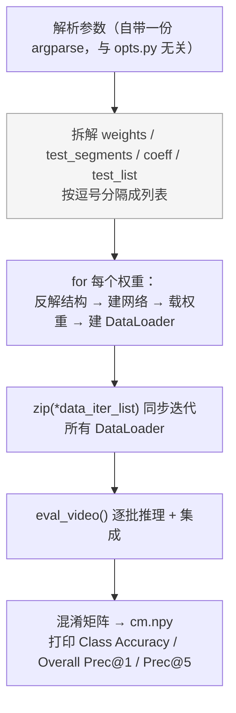

# `test_models.py` — 评测入口

347 行。直接运行即开始评测：

```bash
python test_models.py ipnhand \
  --weights=checkpoint/TSQ_ipnhand_RGB_resnet50_shift0.5_blockres_avg_segment8_e50/ckpt.best.pth.tar \
  --test_segments=8 --test_crops=5 --batch_size=4 -j 32 --multi_clip_test
```

> ⚠️ **本文件没有 `main()` 函数**，绝大部分代码是**模块级语句**，`import` 时就会执行。
> 因此它只能作为脚本运行，无法被 `import` 复用。这是从上游 TSM 继承的结构。

## 模块级执行顺序



---

## 自带的两个工具（与 `ops/utils.py` 重复）

`test_models.py` **没有**从 `ops/utils.py` 导入 `AverageMeter` 与 `accuracy`，
而是自己定义了一份完全相同的实现（第 59–88 行），只从 `ops.utils` 导入了 `load_checkpoint`。
属于上游遗留的代码重复，改一处时要注意另一处。

### `class AverageMeter`

滑动平均累加器。`reset()` 归零；`update(val, n=1)` 累加 `val × n` 并更新 `avg`。
用于 `top1` / `top5` 指标统计。

### `accuracy(output, target, topk=(1,))`

计算 Prec@k。返回**百分数列表**（已乘 100），与 `topk` 一一对应。

```python
_, pred = output.topk(maxk, 1, True, True)   # 取前 maxk 个预测
pred = pred.t()
correct = pred.eq(target.view(1, -1).expand_as(pred))
correct_k = correct[:k].reshape(-1).float().sum(0)
res.append(correct_k.mul_(100.0 / batch_size))
```

---

## `parse_shift_option_from_log_name(log_name)`

**从权重路径的字符串里反解出时序模块配置。**

```python
def parse_shift_option_from_log_name(log_name):
    if 'shift' in log_name:
        strings = log_name.split('_')
        for i, s in enumerate(strings):
            if 'shift' in s: break
        return True, float(strings[i].replace('shift', '')), strings[i + 1]
    else:
        return False, None, None
```

**参数**：`log_name` — 权重文件路径（如 `.../TSQ_ipnhand_RGB_resnet50_shift0.5_blockres_avg_segment8_e50/ckpt.best.pth.tar`）。

**返回**：`(is_shift, shift_div, shift_place)`。无 `shift` 字样时返回 `(False, None, None)`。

**原理**：利用训练时 `main.py` 拼接的 `store_name` 命名规范
`..._shift<div>_<place>_...`，按 `_` 切分后取 `shift` 那一段和它的下一段。

> ⚠️ **这是整条评测链路最脆弱的地方**。
> - 重命名权重文件、或改成不符合该格式的目录结构 → 解析失败或解出错误的值。
> - `shift_div` 解析错 → 权重形状不匹配，`load_state_dict` 会报错（相对安全）。
> - `shift_place` 解析错 → 可能加载成功但语义不一致（**静默错误**）。
>
> 只要权重由本仓库训练脚本产出，命名就是合规的。

同一个 for 循环里还用字符串判断了另外几项（不是函数，是内联逻辑）：

| 判断 | 得到 |
|---|---|
| `'RGB' in this_weights` | `modality`（否则按 Flow 处理） |
| `this_weights.split('TSQ_')[1].split('_')[2]` | `this_arch`，即骨干名 |
| `'_nl' in this_weights` | `non_local` 开关 |

---

## `eval_video(video_data, net, this_test_segments, modality)`

**单个 batch 的推理 + 空间维集成**，是评测的核心。

**参数**：

| 参数 | 说明 |
|---|---|
| `video_data` | `(i, data, label)` 三元组 |
| `net` | 已被 `DataParallel` 包装的网络 |
| `this_test_segments` | 本权重对应的段数 |
| `modality` | `'RGB'` / `'Flow'` / `'RGBDiff'` |

**关键步骤**：

```python
batch_size = label.numel()
num_crop = args.test_crops
if args.dense_sample:   num_crop *= 10
if args.twice_sample:   num_crop *= 2
if args.multi_clip_test: num_crop *= 10        # 本仓库：5 × 10 = 50

length = 3                                     # RGB

data_in = data.view(-1, length, data.size(2), data.size(3))
if is_shift:
    data_in = data_in.view(batch_size * num_crop, this_test_segments, length, ...)

rst = net(data_in)
rst = rst.reshape(batch_size, num_crop, -1).mean(1)   # ← crop 维取平均
if args.softmax: rst = F.softmax(rst, dim=1)
```

**`num_crop` 是累乘出来的**，所以 `--test_crops=5` + `--multi_clip_test` 得到 50：
`data` 的通道维已经是 `8 段 × 3 = 24`，`view(...)` 只是把 24 通道重新解释成 `[段, 通道]`，
真正的「clip 数」由 Dataset 在采样阶段翻倍。

**返回**：`(i, rst, label)`，其中 `rst` 是 `[batch_size, num_class]` 的 numpy 数组。

**注意**：函数内引用了全局的 `is_shift`、`args`、`num_class`（在 for 循环里最后一次迭代的值），
多权重场景下这是上游遗留的作用域问题 —— 本仓库只用单个权重，不受影响。

---

## 集成与指标汇总（模块级代码，第 278–345 行）

```python
for i, data_label_pairs in enumerate(zip(*data_iter_list)):
    for n_seg, (_, (data, label)), net, modality in zip(...):
        rst = eval_video(...); this_rst_list.append(rst[1])
    for i_coeff in range(len(this_rst_list)):
        this_rst_list[i_coeff] *= coeff_list[i_coeff]        # 多权重加权
    ensembled_predict = sum(this_rst_list) / len(this_rst_list)
    prec1, prec5 = accuracy(torch.from_numpy(ensembled_predict), this_label, topk=(1, 5))
```

`zip(*data_iter_list)` 同步迭代多个 DataLoader，实现多权重集成。
本仓库只传一个权重，等价于直接取 `rst[1]`。

### 三种集成维度

| 维度 | 参数 | 处理位置 |
|---|---|---|
| 段（8 段取平均） | `--test_segments=8` | **模型内部** `ConsensusModule` |
| clip（10 组采样） | `--multi_clip_test` | `TSNDataSet.__getitem__` |
| crop（5 个位置） | `--test_crops=5` | 变换链 `GroupOverSample` |

总计算量：每个样本 `8 段 × 5 crop × 10 clip = 400` 次前向，最后对 50 个预测取平均。

### 输出

```python
cf = confusion_matrix(video_labels, video_pred).astype(float)
np.save('cm.npy', cf)
cls_acc = np.diag(cf) / cf.sum(axis=1)
upper = np.mean(np.max(cf, axis=1) / cls_cnt)          # 理论上界
print('Class Accuracy {:.02f}%'.format(np.mean(cls_acc) * 100))
print('Overall Prec@1 {:.02f}% Prec@5 {:.02f}%'.format(top1.avg, top5.avg))
```

**README 的性能表要填的就是最后这两行**：`Overall Prec@1` 与 `Overall Prec@5`。
`cm.npy`（混淆矩阵）已在 `.gitignore` 中排除。

本仓库权重的实测值：**`Overall Prec@1 89.06%`、`Prec@5 99.27%`、`Class Accuracy 83.44%`**
（验证集 1097 段手势、13 类，平均 0.385 秒/样本）。

`upper` 是「每类都取该类最大预测数」得到的**理论上界**（本仓库为 0.8358），
可用来判断混淆矩阵本身是否合理：若它远大于实际 `Class Accuracy`，
说明预测分布过于集中在少数类别。

另外 `--csv_file` 可把逐样本预测导出成 CSV（需要 `--test_list` 提供视频名清单）。

---

## 与 `main.py` 内验证的差异

两者口径不同，**不可直接比较**：

| | `main.py` 的 `validate()` | `test_models.py` |
|---|---|---|
| 采样 | `_get_val_indices` 居中采样（1 组） | 10 组随机 clip |
| 空间 | 单次 `GroupCenterCrop` | 5 crop 过采样 |
| BN | `model.eval()` | `net.eval()` |
| 融合 | 仅 8 段 avg | 8 段 avg → 50 预测再平均 |
| 用途 | 每轮挑 best 模型 | 最终报告数字 |

本仓库实测：验证口径 `Best Prec@1 = 88.97`，测试口径 `Overall Prec@1 = 89.06`
（+0.09）。两者接近是合理的 —— 因为 `ckpt.best.pth.tar` 正是由前者选出的，
而后者在同一权重上叠加了更多 clip/crop 的集成，通常只会略高。
注意训练日志里的逐轮 `Testing Results: Prec@1 87.x ~ 88.x` 比 `Best Prec@1` 低，
那是每轮的即时结果，不是最优权重的结果。

**建议 README 中的性能表统一以本脚本的结果为准。**
